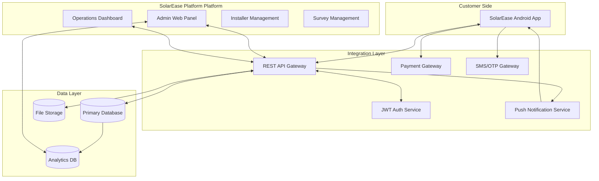
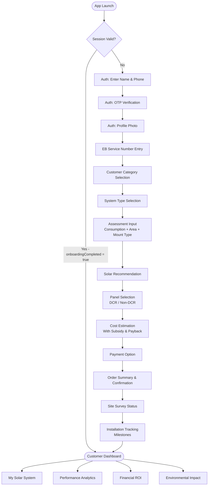
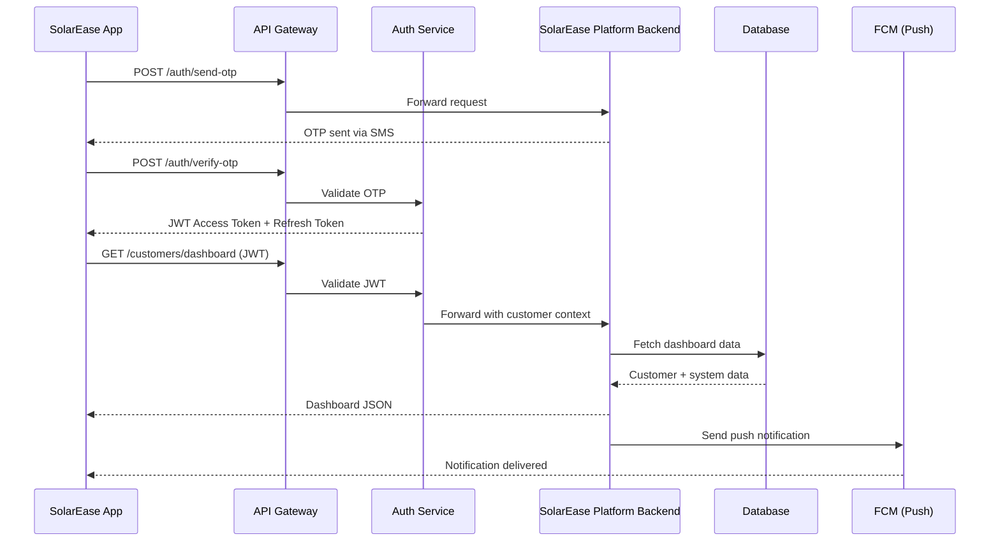

# SolarEase — Complete Project Documentation

> **Internal Technical Reference Document**
> Version 1.0 | Platform: Android | Language: Kotlin | Architecture: MVVM + Clean Architecture

---

## Table of Contents

1. [Project Overview](#1-project-overview)
2. [Project Vision & Operations Platform Integration](#2-project-vision--SolarEase Platform-integration)
3. [Application Modules](#3-application-modules)
4. [Complete User Journey](#4-complete-user-journey)
5. [Solar Calculation Engine](#5-solar-calculation-engine)
6. [Installation Workflows](#6-installation-workflows)
7. [Current Project Status](#7-current-project-status)
8. [Application Architecture](#8-application-architecture)
9. [Operations Platform Integration Plan](#9-SolarEase Platform-integration-plan)
10. [Database Design](#10-database-design)
11. [Admin Panel Modules](#11-admin-panel-modules)
12. [Project Folder Structure](#12-project-folder-structure)
13. [Tech Stack](#13-tech-stack)
14. [Security](#14-security)
15. [Future Roadmap](#15-future-roadmap)
16. [Developer Notes](#16-developer-notes)

---

## 1. Project Overview

### What is SolarEase?

SolarEase is a customer-facing Android application designed to guide residential and commercial customers through the complete solar installation lifecycle — from initial site assessment and system recommendation through payment, installation tracking, and long-term performance monitoring.

The application eliminates the traditionally fragmented, paper-heavy solar installation process by providing a single digital touchpoint for the customer from day one through the operational life of their solar system.

### Business Problem

The solar installation industry in India suffers from several critical pain points that SolarEase is designed to solve:

| Problem | Impact | SolarEase Solution |
|---|---|---|
| No unified customer journey | Customers interact with multiple disconnected systems | Single end-to-end app |
| Manual subsidy calculations | Errors in PM Surya Ghar subsidy eligibility | Automated subsidy engine |
| Lack of installation visibility | Customers have no real-time update on progress | Installation milestone tracker |
| Opaque pricing | No transparency in cost breakdown | Detailed cost estimation with line items |
| Post-installation disconnect | No ongoing engagement after system goes live | Live performance, financial, and environmental dashboard |
| EB service number complexity | TANGEDCO consumer numbers are complex and region-encoded | Automated consumer number parser and region mapper |

### Target Users

- **Residential Customers** — Homeowners looking to install rooftop solar systems (1 kW–10 kW range)
- **Commercial Customers** — Small to medium businesses evaluating solar for operational cost reduction
- **Industrial Customers** — Large-scale ground-mounted or rooftop installations

### Primary Objectives

1. Digitize the end-to-end solar customer acquisition and installation lifecycle
2. Automate solar system sizing, cost estimation, and government subsidy calculation
3. Provide real-time installation milestone tracking
4. Deliver post-installation performance, financial ROI, and environmental impact monitoring
5. Establish a scalable foundation for integration with the SolarEase Platform backend management platform

### Value Proposition

> SolarEase turns a traditionally complex, multi-week engagement into a streamlined digital experience — from the first tap to a live solar system.

Customers get instant system recommendations, transparent cost breakdowns, automated subsidy eligibility, live installation tracking, and lifetime performance analytics — all within a single application.

---

## 2. Project Vision & Operations Platform Integration

### Long-Term Vision

SolarEase is designed to be one half of a two-platform ecosystem. The long-term vision is:

```
Customer App (SolarEase) ←→ REST APIs ←→ SolarEase Operations Platform
```

**SolarEase** handles the customer-facing journey: registration, assessment, ordering, tracking, and monitoring.

**SolarEase Platform** is the internal operations and management platform — a web-based admin application used by the solar installation company's operations team, sales team, engineers, surveyors, and management.

### Platform Responsibilities

| Concern | SolarEase (Customer App) | SolarEase Admin Platform |
|---|---|---|
| Customer registration | ✅ Customer self-registers | ✅ Admin views/manages customers |
| System assessment | ✅ Customer performs self-assessment | ✅ Admin reviews and approves |
| Order management | ✅ Customer places order | ✅ Admin processes and fulfills |
| Survey scheduling | ✅ Customer views survey status | ✅ Admin assigns surveyor |
| Installation tracking | ✅ Customer sees milestone progress | ✅ Admin updates milestones |
| Payment processing | ✅ Customer makes payment | ✅ Admin receives and confirms |
| Performance data | ✅ Customer views dashboard | ✅ Admin monitors fleet health |
| Documents | ✅ Customer downloads documents | ✅ Admin uploads and manages |
| Support | ✅ Customer raises tickets | ✅ Admin responds to tickets |
| Notifications | ✅ Customer receives push notifications | ✅ Admin sends broadcast notifications |

### Ecosystem Architecture



---

## 3. Application Modules

### 3.1 Authentication Module

**Package:** `com.example.feature.auth`

The authentication module handles customer identity verification using mobile number OTP.

#### Screens

| Screen | File | Purpose |
|---|---|---|
| AuthPhoneScreen | `AuthPhoneScreen.kt` | Collects customer name and mobile number, initiates OTP delivery |
| AuthOtpScreen | `AuthOtpScreen.kt` | 6-digit OTP verification with retry logic and attempt limiting |
| AuthProfileScreen | `AuthProfileScreen.kt` | Customer profile photo capture/upload |

#### Business Logic

- OTP is currently hardcoded as `123456` (mock — to be replaced by Firebase Auth or backend OTP service)
- Maximum 3 OTP failure attempts before a 15-minute lockout
- On successful OTP verification, a `User` object is created and persisted to `SharedPreferences` via `UserSession`
- Profile photo is required before proceeding to onboarding

#### State Management

`AuthViewModel` (AndroidViewModel) manages the auth flow with a sealed `AuthUiState`:
- `Idle` → `Loading` → `Success` / `Error`

---

### 3.2 EB Service Number Module

**Package:** `com.example.feature.ebservice`

Captures and validates the customer's TANGEDCO Electricity Board (EB) consumer service number before assessment begins.

#### Screens

| Screen | File | Purpose |
|---|---|---|
| EbServiceNumberScreen | `EbServiceNumberScreen.kt` | Input and validation of 12-digit EB consumer number |

#### Business Logic — Consumer Number Parser

The `ConsumerNumberParser` decodes a 12-digit TANGEDCO consumer number into structured components:

```
Format: RR SSS DDD NNNN
         ^^             = Region Code (2 digits)
            ^^^         = Section Code (3 digits)
                ^^^     = Distribution Code (3 digits)
                    ^^^^ = Service Number (4 digits)
```

**Region Code Mapping** (`RegionCodeMapper`):

| Code | Region |
|---|---|
| 01 | Chennai North |
| 02 | Villupuram |
| 03 | Coimbatore |
| 04 | Erode |
| 05 | Madurai |
| 06 | Trichy |
| 07 | Tirunelveli |
| 08 | Vellore |
| 09 | Chennai South |

Visual formatting is applied via `ConsumerNumberVisualTransformation` (shows as `XX XXX XXX XXXX` while storing raw digits).

---

### 3.3 Assessment Module

**Package:** `com.example.feature.assessment`

The core assessment flow that collects site data and produces a solar system recommendation.

#### Screens

| Screen | File | Purpose |
|---|---|---|
| CustomerCategoryScreen | `CustomerCategoryScreen.kt` | Select customer category: Residential / Commercial / Industrial |
| SystemTypeScreen | `SystemTypeScreen.kt` | Select system type: On-Grid / Off-Grid / Hybrid |
| AssessmentInputScreen | `AssessmentInputScreen.kt` | Enter monthly consumption (kWh), available roof area (sqm), mount type (Rooftop/Ground) |
| RecommendationScreen | `RecommendationScreen.kt` | Displays recommended system capacity, required area, feasibility status |
| PanelSelectionScreen | `PanelSelectionScreen.kt` | Choose panel type: DCR (Domestic Content Requirement) or Non-DCR |
| CostEstimationScreen | `CostEstimationScreen.kt` | Full cost breakdown with subsidy eligibility and payback period |

#### ViewModels

- `SiteDetailsViewModel` — Manages assessment input state
- `EstimateViewModel` — Drives cost estimation and calculation result state

---

### 3.4 Order Module

**Package:** `com.example.feature.order`

Covers the entire post-assessment commercial journey: payment selection, order confirmation, site survey status, and installation tracking.

#### Screens

| Screen | File | Purpose |
|---|---|---|
| PaymentOptionScreen | `PaymentOptionScreen.kt` | Select payment method (Cash / Bank Transfer / Loan / EMI) |
| OrderSummaryScreen | `OrderSummaryScreen.kt` | Final order review and confirmation before submission |
| SiteSurveyStatusScreen | `SiteSurveyStatusScreen.kt` | Real-time status of scheduled physical site survey |
| InstallationTrackingScreen | `InstallationTrackingScreen.kt` | Milestone-by-milestone installation progress tracker |
| RescheduleBottomSheet | `RescheduleBottomSheet.kt` | Allows customers to request reschedule of site survey |

#### ViewModels

- `PaymentViewModel` — Payment method selection and processing
- `OrderConfirmationViewModel` — Order submission state
- `InstallationTrackingViewModel` — Drives the workflow-specific milestone simulation

---

### 3.5 Customer Dashboard Module

**Package:** `com.example.feature.dashboard`

The primary post-installation home screen. Shows live system status, today's generation, savings, and environmental impact at a glance.

#### Data Model — `CustomerDashboard`

```kotlin
data class CustomerDashboard(
    val customerName: String,
    val systemStatus: String,      // "Online" | "Offline" | "Maintenance" | "Fault"
    val capacity: Double,          // System capacity in kW
    val systemType: String,        // "On Grid" | "Off Grid" | "Hybrid"
    val installationDate: String,
    val todayGeneration: Double,   // kWh
    val todaySavings: Double,      // INR
    val todayCo2: Double,          // kg CO2 avoided
    val lifetimeGeneration: Double,
    val lifetimeSavings: Double,
    val lifetimeCo2: Double,
    val plantHealth: Int,          // 0–100
    val recentActivities: List<ActivityItem>,
    val notifications: List<NotificationItem>
)
```

---

### 3.6 My Solar System Module

**Package:** `com.example.feature.systemdetails`

Comprehensive technical details about the installed solar system.

#### Data Coverage

- **Live Status** — Current power output, today's generation, grid status
- **Panel Information** — Manufacturer, model, wattage, count, technology, efficiency, warranty, orientation, tilt angle, mount type
- **Inverter Information** — Manufacturer, model, capacity, serial number, firmware version, warranty, status
- **Installation Information** — Company, engineer name, all key dates (installation, commissioning, grid sync, survey, completion)
- **Roof Layout** — Orientation, area used vs. available
- **System Specifications** — DC/AC capacity, estimated annual generation, performance ratio, net meter number, DISCOM name, connection type
- **Warranty Summary** — Panel, inverter, and installation warranty periods with expiry dates, AMC status
- **System Health** — Overall health score (0–100), generation efficiency, last inspection, dust/cleaning status, next maintenance
- **Service History** — Chronological log of all service events
- **Document Shortcuts** — Quick links to proposal, invoice, warranty certificate, reports, EB approval

---

### 3.7 Performance Module

**Package:** `com.example.feature.performance`

Real-time and historical solar generation performance analytics.

#### Data Coverage

- **Live Generation** — Current power output, today's generation, system/grid status, weather condition
- **Today's Performance** — Energy generated, peak power, operating hours, average efficiency, comparison to yesterday
- **Monthly Performance** — Monthly generation/savings, average daily generation, peak production day, best week
- **Annual Performance** — Annual generation/savings, capacity utilization, total runtime, expected vs. actual
- **Generation History** — Chart data across daily / weekly / monthly / yearly views
- **Energy Flow** — Solar generated, consumed, exported to grid, imported from grid, battery status
- **System Efficiency** — Performance ratio, panel efficiency, inverter efficiency, losses (temperature, shading, dust)
- **Production Forecast** — Expected generation, savings, weather impact, confidence level
- **Performance Insights** — AI/rule-based contextual alerts (positive, neutral, warning)

---

### 3.8 Financial Module

**Package:** `com.example.feature.financial`

Financial ROI tracking and savings analytics.

#### Data Coverage

- **Investment Summary** — Total investment, government subsidy received, net amount paid, estimated annual and daily savings
- **Savings Summary** — Today / current month / current year / lifetime savings (INR)
- **Bill Comparison** — Before vs. after solar monthly bill, monthly and annual reduction, percentage reduction
- **ROI Summary** — Payback period (years), investment recovered, remaining amount, ROI percentage
- **25-Year Projections** — Projected savings, electricity cost avoided, net profit
- **Savings History Charts** — Monthly, quarterly, yearly chart data
- **Subsidy Information** — PM Surya Ghar status, amount received, application status, disbursement date
- **Savings Milestones** — Gamified achievement milestones (e.g., "Saved ₹50,000")
- **Financial Insights** — Contextual alerts and recommendations

---

### 3.9 Environmental Module

**Package:** `com.example.feature.environmental`

Environmental impact tracking and green credentials.

#### Data Coverage

- **Environmental Summary** — CO2 saved (tons), trees equivalent, green energy generated (kWh), impact score
- **Today's Impact** — Green energy (kWh), CO2 reduction (kg), trees equivalent, carbon offset
- **Lifetime Impact** — Green energy (MWh), CO2 reduction (tons), trees equivalent, coal offset, fuel saved (liters)
- **Environmental Comparison** — Trees planted, cars removed from road, coal not burned, petrol saved, homes powered
- **Impact History Charts** — Monthly and yearly CO2 and energy data
- **Sustainability Goals** — Progress towards defined environmental milestones
- **Achievements** — Unlockable badges/achievements (e.g., "Carbon Warrior", "Green Pioneer")
- **Environmental Insights** — Contextual messages about environmental contribution
- **Impact Timeline** — Chronological events and next milestone progress

---

## 4. Complete User Journey

### Journey Overview



---

### Step-by-Step Journey Description

#### Step 1 — App Launch & Session Check

On launch, `MainActivity` initializes `UserSession` from `SharedPreferences`. If `onboardingCompleted == true`, the app navigates directly to the Customer Dashboard. Otherwise, the user starts at the Auth flow.

> In DEBUG builds, the session is always cleared to force the full onboarding flow for testing purposes.

---

#### Step 2 — Phone Number Registration (`AuthPhone`)

The customer enters their full name and 10-digit mobile number. The app validates the number (minimum 10 digits) and initiates OTP delivery.

**Data collected:** `fullName`, `phoneNumber`

---

#### Step 3 — OTP Verification (`AuthOtp`)

A 6-digit OTP is sent to the customer's mobile number. The customer enters the OTP to verify their identity.

- Max 3 attempts allowed
- After 3 failures: 15-minute lockout
- On success: `User` object is created and stored in `UserSession` / `SharedPreferences`

**Data stored:** `User(customerName, mobileNumber)`

---

#### Step 4 — Profile Photo (`AuthProfile`)

The customer uploads or captures a profile photo. This is mandatory before proceeding.

---

#### Step 5 — EB Service Number (`EbServiceNumber`)

The customer enters their 12-digit TANGEDCO consumer number. The app:
1. Validates the number (exactly 12 digits, all numeric)
2. Parses region code, section code, distribution code, and service number
3. Validates the region code against the known TANGEDCO region map
4. Displays the formatted number as `XX XXX XXX XXXX`

**Data stored:** `ebServiceNumber` in `UserSession`

---

#### Step 6 — Customer Category (`CustomerCategory`)

The customer selects their category:
- **Residential** — Home installation
- **Commercial** — Business/office installation
- **Industrial** — Factory/large-scale installation

This selection influences subsidy eligibility (currently subsidy logic is not category-gated, but this is reserved for future policy changes).

---

#### Step 7 — System Type (`SystemType`)

The customer selects the type of solar system:
- **On-Grid** — Connected to the electricity grid; supports net metering and government subsidy
- **Off-Grid** — Fully independent with battery storage; no grid dependency
- **Hybrid** — Battery storage combined with grid connectivity; maximum flexibility

**Business Rule:** Only On-Grid + DCR panel combination qualifies for PM Surya Ghar government subsidy.

---

#### Step 8 — Assessment Input (`AssessmentInput`)

The customer provides:
- **Monthly Electricity Consumption** (kWh) — From their EB bill
- **Available Roof/Ground Area** (sqm) — Space available for panel installation
- **Mount Type** — Rooftop or Ground-mounted

The `EstimateCalculator` immediately computes:
- Recommended system capacity (kW)
- Required installation area (sqm)
- Feasibility status (Suitable / Insufficient Area)

---

#### Step 9 — Solar Recommendation (`Recommendation`)

Displays the system recommendation:
- Recommended capacity in kW
- Required area vs. available area
- Feasibility assessment
- System type confirmation

Customer proceeds to panel selection or navigates back to adjust inputs.

---

#### Step 10 — Panel Selection (`PanelSelection`)

Customer selects panel type:

| Option | Description | Subsidy Eligible |
|---|---|---|
| DCR | Domestic Content Requirement — Indian-manufactured panels | ✅ (On-Grid only) |
| Non-DCR | Imported or mixed panels — generally lower cost | ❌ |

---

#### Step 11 — Cost Estimation (`CostEstimation`)

Full financial breakdown is computed and displayed:
- Base cost per kW (based on panel type and mount type)
- Panels/inverter cost (70% of gross)
- Mounting/wiring cost (18% of gross)
- Labour cost (12% of gross)
- System type add-on (Off-Grid: +₹25,000/kW, Hybrid: +₹20,000/kW)
- Government subsidy (if eligible)
- Net payable after subsidy
- Annual savings estimate
- Estimated payback period

---

#### Step 12 — Payment Option (`PaymentOption`)

Customer selects their preferred payment method:
- Full Cash Payment
- Bank Transfer
- Solar Loan
- EMI Financing

The complete `SolarEstimateResult` is carried forward as navigation arguments into this screen.

---

#### Step 13 — Order Summary (`OrderSummary`)

A final review screen showing:
- System capacity, type, mount, panel type
- Payment method selected
- Gross total, subsidy deduction, net payable

On confirmation, the order is submitted and the customer advances to post-order tracking.

---

#### Step 14 — Site Survey Status (`SiteSurveyStatus`)

After order placement, a physical site survey is scheduled. This screen shows the current status of the survey:
- Scheduled / In Progress / Completed
- Survey date and time (when available)
- Ability to reschedule via `RescheduleBottomSheet`

---

#### Step 15 — Installation Tracking (`InstallationTracking`)

Real-time milestone tracking for the physical installation. Milestones are workflow-specific — different for On-Grid, Off-Grid, and Hybrid systems (see Section 6).

---

#### Step 16 — Customer Dashboard (`CustomerDashboard`)

After installation completes, the app pops back to the auth origin and navigates to the persistent Customer Dashboard. The dashboard provides:
- Live system status and health
- Today's generation, savings, and CO2 impact
- Lifetime totals
- Recent activities and notifications
- Navigation to the four sub-modules: My Solar System, Performance, Financial, Environmental

---

## 5. Solar Calculation Engine

The solar calculation engine lives entirely in `com.example.feature.assessment.util` and is a pure Kotlin object — no Android dependencies, fully unit-testable.

### 5.1 System Capacity Calculation

**File:** `EstimateCalculator.kt`

```
Recommended System Size (kW) = Monthly Consumption (kWh) ÷ DIVISOR

Where DIVISOR = 120.0
```

**Rationale:** The divisor of 120 is derived from the assumption of approximately 4 peak sun hours per day × 30 days = 120 peak sun hours per month. This gives the DC system size required to offset the monthly consumption.

The result is rounded to 1 decimal place.

**Example:**
- Monthly Consumption = 300 kWh
- Recommended Size = 300 ÷ 120 = **2.5 kW**

---

### 5.2 Area Requirement Calculation

```
Required Area (sqm) = Recommended Capacity (kW) × AREA_PER_KW

Where AREA_PER_KW = 10.0 sqm/kW
```

**Rationale:** Standard residential solar panel (approximately 400W) occupies approximately 2 sqm. A 1 kW system requires approximately 2.5 panels, therefore approximately 10 sqm per kW.

**Example:**
- System Size = 2.5 kW
- Required Area = 2.5 × 10 = **25 sqm**

**Feasibility Check:**
```
if (requiredArea <= availableArea) → "Suitable"
else → "Insufficient Area"
```

---

### 5.3 Cost Calculation

#### Base Rate Matrix

| Panel Type | Mount Type | Base Rate (INR/kW) |
|---|---|---|
| DCR | Ground | ₹62,000 |
| DCR | Rooftop | ₹55,000 |
| Non-DCR | Ground | ₹54,000 |
| Non-DCR | Rooftop | ₹48,000 |

#### System Type Add-on Cost

| System Type | Additional Cost (INR/kW) |
|---|---|
| On-Grid | ₹0 (no addition) |
| Hybrid | +₹20,000 |
| Off-Grid | +₹25,000 |

#### Final Cost Calculation

```
Final Rate per kW = Base Rate + System Type Add-on
Gross Total = Recommended Capacity × Final Rate per kW
```

#### Cost Component Breakdown

| Component | Percentage of Gross Total |
|---|---|
| Panels + Inverter | 70% |
| Mounting Structure + Wiring | 18% |
| Installation + Labour | 12% |

**Example — 2.5 kW, On-Grid, DCR, Rooftop:**
```
Final Rate = ₹55,000 + ₹0 = ₹55,000/kW
Gross Total = 2.5 × ₹55,000 = ₹1,37,500
Panels/Inverter = ₹1,37,500 × 0.70 = ₹96,250
Mounting/Wiring = ₹1,37,500 × 0.18 = ₹24,750
Labour = ₹1,37,500 × 0.12 = ₹16,500
```

---

### 5.4 Government Subsidy Calculation (PM Surya Ghar)

**File:** `SubsidyCalculator.kt`

#### Eligibility Rules

Subsidy is applicable **only** when:
1. System Type = **On-Grid**
2. Panel Type = **DCR**

Both conditions must be true. All other combinations return `eligible = false`.

#### Subsidy Tier Structure

| Capacity Range | Subsidy Formula |
|---|---|
| Up to 2 kW | ₹30,000 × capacity (kW) |
| 2 kW to 3 kW | ₹60,000 + (₹18,000 × (capacity − 2)) |
| Above 3 kW | ₹78,000 (capped) |

**Examples:**

| Capacity | Calculation | Subsidy Amount |
|---|---|---|
| 1 kW | 1 × ₹30,000 | ₹30,000 |
| 2 kW | 2 × ₹30,000 | ₹60,000 |
| 2.5 kW | ₹60,000 + (0.5 × ₹18,000) | ₹69,000 |
| 3 kW | ₹60,000 + (1 × ₹18,000) | ₹78,000 |
| 5 kW | Capped at | ₹78,000 |
| 10 kW | Capped at | ₹78,000 |

---

### 5.5 Net Payable Calculation

```
Net Payable = Gross Total − Subsidy Amount

If Net Payable < 0 → Net Payable = 0  (subsidy cannot exceed system cost)
```

---

### 5.6 Annual Savings & Payback Period

**Electricity Tariff Rate:** `TARIFF_PER_KWH = ₹7.00/kWh`

```
Annual Savings (INR) = Monthly Consumption (kWh) × 12 × ₹7.00

Payback Period (years) = Net Payable ÷ Annual Savings
```

Result is rounded to 1 decimal place.

**Example — 2.5 kW, 300 kWh/month, On-Grid, DCR, Rooftop:**
```
Annual Savings = 300 × 12 × 7 = ₹25,200/year
Net Payable = ₹1,37,500 − ₹69,000 = ₹68,500
Payback Period = ₹68,500 ÷ ₹25,200 = 2.7 years
```

---

### 5.7 Input Validation Rules

**File:** `Validation.kt`

| Field | Rule |
|---|---|
| Monthly Consumption | Must be a positive number, maximum 5 digits |
| Available Area | Must be a positive number, maximum 100,000 sqm |

---

## 6. Installation Workflows

Each system type (On-Grid, Off-Grid, Hybrid) has a distinct installation workflow due to different technical requirements. The `InstallationRepositoryImpl` manages three separate milestone flows.

### 6.1 On-Grid Installation Workflow

**Applicable when:** `systemType == "On-Grid"` or default

**Why different:** On-Grid systems must connect to the electricity grid, which requires EB/DISCOM inspection, net meter installation, and formal grid synchronization — regulatory steps not required for Off-Grid systems.

```mermaid
flowchart LR
    A[Site Survey Completed] --> B[Feasibility & Load Sanction Approved]
    B --> C[Materials Dispatched]
    C --> D[Installation In Progress]
    D --> E[Installation Completed]
    E --> F[Testing & Internal Commissioning WCR]
    F --> G[EB / DISCOM Physical Inspection]
    G --> H[Net Meter Installed & Approved]
    H --> I[Grid Synchronization]
    I --> J[Project Completed & System Live]
```



| # | Milestone Key | Title | Description |
|---|---|---|---|
| 1 | `SITE_SURVEY_COMPLETED` | Site Survey Completed | Physical site inspection; technical data collected |
| 2 | `FEASIBILITY_APPROVED` | Feasibility & Load Sanction Approved | Technical feasibility verified; regulatory approvals obtained |
| 3 | `MATERIALS_DISPATCHED` | Materials Dispatched | Panels, inverter, mounting structure shipped |
| 4 | `INSTALLATION_IN_PROGRESS` | Installation In Progress | On-site installation with sub-activities and progress percentage |
| 5 | `INSTALLATION_COMPLETED` | Installation Completed | Mechanical and electrical installation done |
| 6 | `TESTING_WCR` | Testing & Internal Commissioning (WCR) | Electrical testing, inverter configuration, internal commissioning |
| 7 | `EB_INSPECTION` | EB / DISCOM Physical Inspection | Electricity Board official inspection |
| 8 | `NET_METER_INSTALLED` | Net Meter Installed & Approved | Bidirectional meter installed and approved |
| 9 | `GRID_SYNC` | Grid Synchronization | System synchronized with the electricity grid |
| 10 | `SYSTEM_LIVE` | Project Completed & System Live | System fully operational |

**Sub-activities during INSTALLATION_IN_PROGRESS:**
1. Mounting Structure Installation
2. Solar Panel Installation
3. Inverter Installation
4. Electrical Wiring

---

### 6.2 Off-Grid Installation Workflow

**Applicable when:** `systemType == "Off-Grid"`

**Why different:** Off-Grid systems include battery banks and do not connect to the electricity grid. There is no need for EB inspection, net meter, or grid synchronization. Instead, a battery sizing/load audit and battery backup verification replace those steps.

```mermaid
flowchart LR
    A[Site Survey Completed] --> B[Site Feasibility & Load Audit]
    B --> C[Materials & Batteries Dispatched]
    C --> D[Installation In Progress]
    D --> E[Installation Completed]
    E --> F[Testing & Battery Commissioning]
    F --> G[Battery Backup Verification]
    G --> H[System Live & Customer Handover]
    H --> I[Project Completed]
```



| # | Milestone Key | Title | Description |
|---|---|---|---|
| 1 | `SITE_SURVEY_COMPLETED` | Site Survey Completed | Site inspection; installation requirements verified |
| 2 | `SITE_FEASIBILITY` | Site Feasibility & Load Audit | Power requirements and battery sizing verified |
| 3 | `MATERIALS_DISPATCHED` | Materials & Batteries Dispatched | Panels, inverter, batteries, mounting structure shipped |
| 4 | `INSTALLATION_IN_PROGRESS` | Installation In Progress | On-site installation with sub-activities |
| 5 | `INSTALLATION_COMPLETED` | Installation Completed | Mechanical and electrical installation done |
| 6 | `TESTING_COMMISSIONING` | Testing & Battery Commissioning | Battery charging, inverter config, commissioning |
| 7 | `BATTERY_VERIFICATION` | Battery Backup Verification | Battery performance, charging, discharge, protection verified |
| 8 | `SYSTEM_LIVE` | System Live & Customer Handover | System commissioned and handed over |
| 9 | `PROJECT_COMPLETED` | Project Completed | Off-Grid system fully operational |

**Sub-activities during INSTALLATION_IN_PROGRESS:**
1. Mounting Structure Installation
2. Solar Panel Installation
3. Battery Installation
4. Inverter Installation
5. Electrical Wiring

---

### 6.3 Hybrid Installation Workflow

**Applicable when:** `systemType == "Hybrid"`

**Why different:** Hybrid systems combine battery storage with grid connectivity. They require both the battery commissioning steps of Off-Grid AND the EB inspection/net meter/grid sync steps of On-Grid — making this the most complex workflow.

```mermaid
flowchart LR
    A[Site Survey Completed] --> B[Feasibility & Load Sanction Approved]
    B --> C[Materials & Batteries Dispatched]
    C --> D[Installation In Progress]
    D --> E[Installation Completed]
    E --> F[Testing & Battery Commissioning]
    F --> G[EB / DISCOM Physical Inspection]
    G --> H[Net Meter Installed & Approved]
    H --> I[Grid Synchronization]
    I --> J[System Live & Customer Handover]
    J --> K[Project Completed]
```



| # | Milestone Key | Title | Description |
|---|---|---|---|
| 1 | `SITE_SURVEY_COMPLETED` | Site Survey Completed | Site inspection; installation requirements verified |
| 2 | `FEASIBILITY_APPROVED` | Feasibility & Load Sanction Approved | Technical feasibility; required approvals obtained |
| 3 | `MATERIALS_DISPATCHED` | Materials & Batteries Dispatched | Panels, inverter, batteries, mounting structure shipped |
| 4 | `INSTALLATION_IN_PROGRESS` | Installation In Progress | On-site installation with sub-activities |
| 5 | `INSTALLATION_COMPLETED` | Installation Completed | Mechanical and electrical installation done |
| 6 | `TESTING_COMMISSIONING` | Testing & Battery Commissioning | Battery + hybrid inverter commissioning |
| 7 | `EB_INSPECTION` | EB / DISCOM Physical Inspection | EB official inspection for grid connectivity |
| 8 | `NET_METER_INSTALLED` | Net Meter Installed & Approved | Net meter installed and EB-approved |
| 9 | `GRID_SYNC` | Grid Synchronization | Hybrid system synchronized with grid |
| 10 | `SYSTEM_LIVE` | System Live & Customer Handover | System commissioned and handed over |
| 11 | `PROJECT_COMPLETED` | Project Completed | Hybrid system fully operational |

**Sub-activities during INSTALLATION_IN_PROGRESS:**
1. Mounting Structure Installation
2. Solar Panel Installation
3. Battery Installation
4. Hybrid Inverter Installation
5. Electrical Wiring

---

### 6.4 Milestone Progression Rules

- Only one milestone is `IN_PROGRESS` at a time
- When a milestone is marked `COMPLETED`, the next milestone automatically transitions to `IN_PROGRESS`
- The `INSTALLATION_IN_PROGRESS` milestone supports a percentage progress (0–100) and a `currentActivity` string
- Completion timestamps are recorded in `dd MMM yyyy, hh:mm a` format

---

## 7. Current Project Status

### Completed Modules

| Module | Status | Notes |
|---|---|---|
| Authentication (Phone + OTP) | ✅ Complete | Mock OTP: `123456` |
| Profile Setup | ✅ Complete | Photo reference only, no actual upload |
| EB Service Number Entry & Parsing | ✅ Complete | TANGEDCO format only |
| Customer Category Selection | ✅ Complete | |
| System Type Selection | ✅ Complete | On-Grid / Off-Grid / Hybrid |
| Assessment Input | ✅ Complete | Consumption, area, mount type |
| Solar Recommendation Engine | ✅ Complete | Capacity + area calculation |
| Panel Selection (DCR / Non-DCR) | ✅ Complete | |
| Cost Estimation Engine | ✅ Complete | Full breakdown with subsidy |
| PM Surya Ghar Subsidy Calculator | ✅ Complete | All tiers implemented |
| Payback Period Calculation | ✅ Complete | |
| Payment Option Selection | ✅ Complete | UI only, no gateway integration |
| Order Summary & Confirmation | ✅ Complete | |
| Site Survey Status Screen | ✅ Complete | Static/mock data |
| Installation Tracking — On-Grid | ✅ Complete | Simulated milestone progression |
| Installation Tracking — Off-Grid | ✅ Complete | Simulated milestone progression |
| Installation Tracking — Hybrid | ✅ Complete | Simulated milestone progression |
| Customer Dashboard | ✅ Complete | Mock data |
| My Solar System Details | ✅ Complete | Mock data |
| Performance Analytics | ✅ Complete | Mock data |
| Financial Analytics | ✅ Complete | Mock data |
| Environmental Impact | ✅ Complete | Mock data |
| Navigation Graph | ✅ Complete | Type-safe with Kotlin Serialization |
| Session Management | ✅ Complete | SharedPreferences-based |

### Pending Modules (Require Backend Integration)

| Module | Priority | Dependency |
|---|---|---|
| Real OTP delivery | High | Firebase Auth / SMS Gateway |
| Real API integration (all modules) | High | SolarEase Platform backend |
| Payment gateway integration | High | Razorpay / PayU / bank transfer |
| Document upload and download | High | File storage backend |
| GeoTag photo capture | Medium | Camera permission + GPS |
| Push notifications | Medium | FCM integration |
| Support / ticket raising | Medium | Backend |
| AMC / maintenance scheduling | Low | Backend |
| IoT / live inverter data | Future | Inverter API integration |

### Known Limitations & Dummy Data

| Limitation | Location | Fix Required |
|---|---|---|
| OTP hardcoded to `123456` | `AuthViewModel.verifyOtp()` | Replace with real OTP service |
| All dashboard data is mock | `DashboardRepositoryImpl` | Replace with API call |
| Performance data is mock | `PerformanceRepositoryImpl` | Replace with API call |
| Financial data is mock | `FinancialRepositoryImpl` | Replace with API call |
| Environmental data is mock | `EnvironmentalRepositoryImpl` | Replace with API call |
| System details are mock | `SystemDetailsRepositoryImpl` | Replace with API call |
| Installation milestones are simulated | `InstallationRepositoryImpl` | Replace with real-time API polling |
| Session clear on DEBUG builds | `MainActivity.onCreate()` | Remove for production |
| No payment gateway connected | `PaymentViewModel` | Integrate payment SDK |
| Customer type does not affect subsidy | `SubsidyCalculator` | Extend when policy requires |

---

## 8. Application Architecture

### Architectural Pattern: MVVM + Clean Architecture

SolarEase follows a layered architecture combining MVVM (Model-View-ViewModel) at the presentation layer with Clean Architecture principles for separation of concerns.

```
┌─────────────────────────────────────────────────────┐
│                  UI Layer (Compose)                  │
│          Screens + Route Composables                 │
└──────────────────────┬──────────────────────────────┘
                       │ observes state
┌──────────────────────▼──────────────────────────────┐
│               ViewModel Layer                        │
│    AndroidViewModel / ViewModel + StateFlow          │
└──────────────────────┬──────────────────────────────┘
                       │ calls
┌──────────────────────▼──────────────────────────────┐
│              Repository (Interface)                  │
│         Domain Layer — Pure Kotlin                   │
└──────────────────────┬──────────────────────────────┘
                       │ implemented by
┌──────────────────────▼──────────────────────────────┐
│            Repository Implementation                 │
│      Data Layer — Retrofit / Room / Mock             │
└─────────────────────────────────────────────────────┘
```

### Layer Responsibilities

#### UI Layer (Jetpack Compose)

- All screens are Composable functions
- Each feature has a `Route` composable that wires the ViewModel to the screen
- Navigation is handled by `NavHostController` via type-safe `Screen` sealed class routes
- No business logic in Composables — only UI rendering and user event forwarding

#### ViewModel Layer

- `ViewModel` or `AndroidViewModel` (when `Application` context is needed, e.g., `AuthViewModel` for SharedPreferences)
- State is exposed as `StateFlow<UiState>` or `StateFlow<List<Model>>`
- All async operations use `viewModelScope.launch` with Kotlin Coroutines
- ViewModels do not hold references to Composables or Android Views

#### Domain Layer

- Pure Kotlin interfaces (`DashboardRepository`, `FinancialRepository`, etc.)
- Domain model data classes with no Android imports
- Calculation utilities (`EstimateCalculator`, `SubsidyCalculator`) are pure Kotlin objects

#### Data Layer

- Repository implementations (`DashboardRepositoryImpl`, `InstallationRepositoryImpl`, etc.)
- Currently uses mock data with simulated network delays (`delay()`)
- Designed for straightforward replacement with Retrofit API calls

### State Management

All UI state follows the sealed class pattern:

```kotlin
sealed class SomeUiState {
    data object Idle : SomeUiState()
    data object Loading : SomeUiState()
    data class Success(val data: SomeModel) : SomeUiState()
    data class Error(val message: String) : SomeUiState()
}
```

State is collected in the Composable using `collectAsStateWithLifecycle()`.

### Navigation

Navigation uses Jetpack Navigation Compose with **type-safe routes** via `@Serializable` data objects and data classes:

```kotlin
@Serializable
data class CostEstimation(
    val monthlyConsumption: Double,
    val availableArea: Double,
    val mountType: String,
    val systemType: String,
    val panelType: String,
    val customerType: String
) : Screen()
```

Route arguments are passed as typed navigation parameters (not string-encoded bundles), providing compile-time safety.

### Session Persistence

`UserSession` (singleton object) manages the authenticated user state:
- Loaded from `SharedPreferences` on app start
- Updated on login and profile completion
- Cleared on logout or DEBUG build launch
- Serialized/deserialized using `kotlinx.serialization`

```kotlin
data class User(
    val customerName: String,
    val mobileNumber: String,
    val ebServiceNumber: String? = null,
    val registrationCompleted: Boolean = false,
    val onboardingCompleted: Boolean = false,
    val installationCompleted: Boolean = false
)
```

---

## 9. Operations Platform Integration Plan

### Overview

All current mock data implementations must be replaced with real API calls to the SolarEase Platform backend. The integration follows a standard REST architecture with JWT authentication.

### Integration Architecture



---

### API Specification

#### Base URL Pattern
```
https://api.solarease.in/v1/
```

---

#### Authentication APIs

| Method | Endpoint | Description |
|---|---|---|
| POST | `/auth/send-otp` | Send OTP to mobile number |
| POST | `/auth/verify-otp` | Verify OTP and return JWT tokens |
| POST | `/auth/refresh-token` | Refresh expired access token |
| POST | `/auth/logout` | Invalidate refresh token |

**POST /auth/send-otp — Request:**
```json
{
  "phoneNumber": "9876543210"
}
```

**POST /auth/verify-otp — Request:**
```json
{
  "phoneNumber": "9876543210",
  "otp": "123456",
  "fullName": "Customer Name"
}
```

**POST /auth/verify-otp — Response:**
```json
{
  "accessToken": "eyJ...",
  "refreshToken": "eyJ...",
  "expiresIn": 3600,
  "customer": {
    "customerId": "CUST-001",
    "customerName": "Customer Name",
    "mobileNumber": "9876543210",
    "onboardingCompleted": false
  }
}
```

---

#### Customer APIs

| Method | Endpoint | Description |
|---|---|---|
| POST | `/customers/profile` | Submit profile photo |
| PUT | `/customers/eb-number` | Save EB service number |
| GET | `/customers/me` | Get current customer profile |
| PUT | `/customers/me` | Update customer profile |

---

#### Assessment & Order APIs

| Method | Endpoint | Description |
|---|---|---|
| POST | `/assessment/estimate` | Submit assessment inputs; receive estimate result |
| POST | `/orders` | Place a new solar order |
| GET | `/orders/:orderId` | Get order details |
| GET | `/orders/active` | Get the active order for the current customer |
| PUT | `/orders/:orderId/payment` | Submit payment information |

**POST /assessment/estimate — Request:**
```json
{
  "monthlyConsumptionKwh": 300,
  "availableAreaSqm": 50,
  "mountType": "Rooftop",
  "systemType": "On-Grid",
  "panelType": "DCR",
  "customerType": "Residential"
}
```

**POST /orders — Request:**
```json
{
  "estimateId": "EST-001",
  "paymentMethod": "Bank Transfer",
  "systemCapacityKw": 2.5,
  "systemType": "On-Grid",
  "mountType": "Rooftop",
  "panelType": "DCR",
  "grossTotal": 137500,
  "subsidyAmount": 69000,
  "netPayable": 68500
}
```

---

#### Survey APIs

| Method | Endpoint | Description |
|---|---|---|
| GET | `/survey/:orderId` | Get site survey status for an order |
| PUT | `/survey/:surveyId/reschedule` | Request reschedule of site survey |
| POST | `/survey/:surveyId/complete` | Mark survey as complete (admin only) |

---

#### Installation APIs

| Method | Endpoint | Description |
|---|---|---|
| GET | `/installation/:orderId/milestones` | Get all milestones for an order |
| GET | `/installation/:orderId/milestones/active` | Get current active milestone |
| PUT | `/installation/milestones/:milestoneId/progress` | Update milestone progress (admin only) |
| PUT | `/installation/milestones/:milestoneId/complete` | Mark milestone complete (admin only) |

**GET /installation/:orderId/milestones — Response:**
```json
{
  "systemType": "On-Grid",
  "milestones": [
    {
      "id": "m-001",
      "key": "SITE_SURVEY_COMPLETED",
      "title": "Site Survey Completed",
      "description": "...",
      "status": "COMPLETED",
      "completedAt": "2026-08-11T14:00:00Z",
      "progress": null,
      "currentActivity": null
    }
  ]
}
```

---

#### Dashboard APIs

| Method | Endpoint | Description |
|---|---|---|
| GET | `/dashboard` | Get customer dashboard summary |
| GET | `/dashboard/performance` | Get performance analytics data |
| GET | `/dashboard/financial` | Get financial analytics data |
| GET | `/dashboard/environmental` | Get environmental impact data |
| GET | `/dashboard/system-details` | Get detailed system information |

---

#### Documents APIs

| Method | Endpoint | Description |
|---|---|---|
| GET | `/documents` | List all customer documents |
| GET | `/documents/:documentId/download` | Download a specific document |
| POST | `/documents/upload` | Upload a document (customer — profile photo, etc.) |

---

#### Support APIs

| Method | Endpoint | Description |
|---|---|---|
| GET | `/support/tickets` | List all support tickets for the customer |
| POST | `/support/tickets` | Raise a new support ticket |
| GET | `/support/tickets/:ticketId` | Get ticket details and conversation |
| POST | `/support/tickets/:ticketId/reply` | Reply to a support ticket |
| PUT | `/support/tickets/:ticketId/close` | Close a ticket |

---

#### Notifications APIs

| Method | Endpoint | Description |
|---|---|---|
| GET | `/notifications` | Get all notifications for the customer |
| PUT | `/notifications/:notificationId/read` | Mark a notification as read |
| PUT | `/notifications/read-all` | Mark all notifications as read |
| POST | `/notifications/register-device` | Register FCM device token |

---

## 10. Database Design

The following tables describe the complete data model required for the SolarEase Platform backend database.

---

### 10.1 `users` Table

Stores authentication credentials for all platform users (customers and admin staff).

| Column | Type | Description |
|---|---|---|
| `id` | UUID (PK) | Unique user identifier |
| `mobile_number` | VARCHAR(15) UNIQUE | Mobile number (primary login identifier) |
| `role` | ENUM | `CUSTOMER`, `ADMIN`, `SURVEYOR`, `INSTALLER`, `SUPPORT` |
| `otp_hash` | VARCHAR(255) | Hashed OTP for verification |
| `otp_expires_at` | TIMESTAMP | OTP expiry time |
| `otp_attempt_count` | INT | Failed OTP attempt counter |
| `otp_locked_until` | TIMESTAMP NULL | Lockout expiry after max failures |
| `is_active` | BOOLEAN | Account active status |
| `created_at` | TIMESTAMP | Account creation timestamp |
| `updated_at` | TIMESTAMP | Last update timestamp |

---

### 10.2 `customers` Table

Extended profile for customers.

| Column | Type | Description |
|---|---|---|
| `id` | UUID (PK) | Unique customer ID |
| `user_id` | UUID (FK → users) | Linked auth user |
| `customer_name` | VARCHAR(255) | Full name |
| `email` | VARCHAR(255) NULL | Optional email |
| `profile_photo_url` | VARCHAR(512) NULL | Profile photo storage URL |
| `eb_service_number` | VARCHAR(20) NULL | TANGEDCO consumer number |
| `eb_region_code` | VARCHAR(5) NULL | Parsed region code |
| `eb_region_name` | VARCHAR(100) NULL | Parsed region name |
| `customer_type` | ENUM | `RESIDENTIAL`, `COMMERCIAL`, `INDUSTRIAL` |
| `registration_completed` | BOOLEAN | Profile setup done |
| `onboarding_completed` | BOOLEAN | Full onboarding done |
| `installation_completed` | BOOLEAN | Installation done |
| `created_at` | TIMESTAMP | |
| `updated_at` | TIMESTAMP | |

---

### 10.3 `estimates` Table

Stores solar assessment estimates.

| Column | Type | Description |
|---|---|---|
| `id` | UUID (PK) | Estimate ID |
| `customer_id` | UUID (FK → customers) | Associated customer |
| `monthly_consumption_kwh` | DECIMAL(10,2) | Input: monthly consumption |
| `available_area_sqm` | DECIMAL(10,2) | Input: available area |
| `mount_type` | ENUM | `ROOFTOP`, `GROUND` |
| `system_type` | ENUM | `ON_GRID`, `OFF_GRID`, `HYBRID` |
| `panel_type` | ENUM | `DCR`, `NON_DCR` |
| `recommended_capacity_kw` | DECIMAL(10,2) | Computed: system size |
| `required_area_sqm` | DECIMAL(10,2) | Computed: required area |
| `area_status` | VARCHAR(50) | `Suitable` / `Insufficient Area` |
| `base_rate_per_kw` | DECIMAL(12,2) | Rate used |
| `gross_total` | DECIMAL(12,2) | Before subsidy |
| `subsidy_eligible` | BOOLEAN | Subsidy eligibility |
| `subsidy_amount` | DECIMAL(12,2) | Subsidy amount |
| `net_payable` | DECIMAL(12,2) | After subsidy |
| `annual_savings` | DECIMAL(12,2) | Estimated annual savings |
| `payback_years` | DECIMAL(5,1) | Estimated payback |
| `created_at` | TIMESTAMP | |

---

### 10.4 `orders` Table

| Column | Type | Description |
|---|---|---|
| `id` | UUID (PK) | Order ID |
| `customer_id` | UUID (FK → customers) | Customer placing the order |
| `estimate_id` | UUID (FK → estimates) | Linked estimate |
| `order_status` | ENUM | `PENDING`, `CONFIRMED`, `IN_SURVEY`, `IN_INSTALLATION`, `COMPLETED`, `CANCELLED` |
| `system_capacity_kw` | DECIMAL(10,2) | Final system size |
| `system_type` | ENUM | `ON_GRID`, `OFF_GRID`, `HYBRID` |
| `mount_type` | ENUM | `ROOFTOP`, `GROUND` |
| `panel_type` | ENUM | `DCR`, `NON_DCR` |
| `gross_total` | DECIMAL(12,2) | |
| `subsidy_amount` | DECIMAL(12,2) | |
| `net_payable` | DECIMAL(12,2) | |
| `payment_method` | ENUM | `CASH`, `BANK_TRANSFER`, `LOAN`, `EMI` |
| `payment_status` | ENUM | `PENDING`, `PARTIAL`, `COMPLETED` |
| `created_at` | TIMESTAMP | |
| `updated_at` | TIMESTAMP | |

---

### 10.5 `payments` Table

| Column | Type | Description |
|---|---|---|
| `id` | UUID (PK) | Payment transaction ID |
| `order_id` | UUID (FK → orders) | Linked order |
| `amount` | DECIMAL(12,2) | Amount paid |
| `payment_method` | ENUM | `CASH`, `BANK_TRANSFER`, `LOAN`, `EMI` |
| `payment_status` | ENUM | `PENDING`, `SUCCESS`, `FAILED`, `REFUNDED` |
| `transaction_reference` | VARCHAR(255) NULL | Gateway reference |
| `paid_at` | TIMESTAMP NULL | Payment timestamp |
| `created_at` | TIMESTAMP | |

---

### 10.6 `surveys` Table

| Column | Type | Description |
|---|---|---|
| `id` | UUID (PK) | Survey ID |
| `order_id` | UUID (FK → orders) | Linked order |
| `surveyor_id` | UUID (FK → users) NULL | Assigned surveyor |
| `status` | ENUM | `PENDING`, `SCHEDULED`, `IN_PROGRESS`, `COMPLETED`, `RESCHEDULED` |
| `scheduled_at` | TIMESTAMP NULL | Planned survey date/time |
| `completed_at` | TIMESTAMP NULL | Actual completion |
| `notes` | TEXT NULL | Surveyor notes |
| `report_url` | VARCHAR(512) NULL | Survey report file URL |
| `created_at` | TIMESTAMP | |
| `updated_at` | TIMESTAMP | |

---

### 10.7 `installations` Table

| Column | Type | Description |
|---|---|---|
| `id` | UUID (PK) | Installation ID |
| `order_id` | UUID (FK → orders) | Linked order |
| `installer_id` | UUID (FK → users) NULL | Assigned installation engineer |
| `status` | ENUM | `PENDING`, `IN_PROGRESS`, `COMPLETED` |
| `started_at` | TIMESTAMP NULL | |
| `completed_at` | TIMESTAMP NULL | |
| `system_type` | ENUM | Determines milestone template |
| `created_at` | TIMESTAMP | |

---

### 10.8 `installation_milestones` Table

| Column | Type | Description |
|---|---|---|
| `id` | UUID (PK) | Milestone instance ID |
| `installation_id` | UUID (FK → installations) | Linked installation |
| `milestone_key` | VARCHAR(100) | e.g., `SITE_SURVEY_COMPLETED` |
| `title` | VARCHAR(255) | Display title |
| `description` | TEXT | Milestone description |
| `status` | ENUM | `PENDING`, `IN_PROGRESS`, `COMPLETED` |
| `progress` | INT NULL | 0–100 percentage |
| `current_activity` | VARCHAR(255) NULL | Current sub-activity |
| `expected_completion` | TIMESTAMP NULL | Estimated completion |
| `completed_at` | TIMESTAMP NULL | Actual completion |
| `remarks` | TEXT NULL | Admin remarks |
| `tracking_id` | VARCHAR(100) NULL | For material tracking |
| `created_at` | TIMESTAMP | |
| `updated_at` | TIMESTAMP | |

---

### 10.9 `solar_systems` Table

Installed system details linked to a completed order.

| Column | Type | Description |
|---|---|---|
| `id` | UUID (PK) | System ID |
| `customer_id` | UUID (FK → customers) | Owner |
| `order_id` | UUID (FK → orders) | Source order |
| `system_capacity_kw` | DECIMAL(10,2) | |
| `system_type` | ENUM | |
| `plant_status` | ENUM | `ONLINE`, `OFFLINE`, `MAINTENANCE`, `FAULT` |
| `installation_date` | DATE | |
| `commissioning_date` | DATE | |
| `grid_sync_date` | DATE NULL | On-Grid / Hybrid only |
| `net_meter_number` | VARCHAR(100) NULL | |
| `electricity_board` | VARCHAR(255) NULL | |
| `panel_manufacturer` | VARCHAR(255) | |
| `panel_model` | VARCHAR(255) | |
| `panel_wattage` | INT | |
| `panel_count` | INT | |
| `inverter_manufacturer` | VARCHAR(255) | |
| `inverter_model` | VARCHAR(255) | |
| `inverter_serial_number` | VARCHAR(255) | |
| `installation_address` | TEXT | |
| `plant_health` | INT | 0–100 |
| `created_at` | TIMESTAMP | |
| `updated_at` | TIMESTAMP | |

---

### 10.10 `notifications` Table

| Column | Type | Description |
|---|---|---|
| `id` | UUID (PK) | |
| `customer_id` | UUID (FK → customers) | Target customer |
| `message` | TEXT | Notification body |
| `type` | ENUM | `INFO`, `ALERT`, `SUCCESS`, `WARNING` |
| `is_read` | BOOLEAN | |
| `created_at` | TIMESTAMP | |

---

### 10.11 `documents` Table

| Column | Type | Description |
|---|---|---|
| `id` | UUID (PK) | |
| `customer_id` | UUID (FK → customers) | |
| `order_id` | UUID (FK → orders) NULL | |
| `document_type` | ENUM | `PROPOSAL`, `INVOICE`, `WARRANTY`, `REPORT`, `EB_APPROVAL`, `SUBSIDY_CERTIFICATE` |
| `title` | VARCHAR(255) | Display name |
| `file_url` | VARCHAR(512) | Storage URL |
| `uploaded_by` | UUID (FK → users) | Uploader |
| `created_at` | TIMESTAMP | |

---

### 10.12 `support_tickets` Table

| Column | Type | Description |
|---|---|---|
| `id` | UUID (PK) | Ticket ID |
| `customer_id` | UUID (FK → customers) | Raised by |
| `assigned_to` | UUID (FK → users) NULL | Support agent |
| `subject` | VARCHAR(500) | |
| `status` | ENUM | `OPEN`, `IN_PROGRESS`, `RESOLVED`, `CLOSED` |
| `priority` | ENUM | `LOW`, `MEDIUM`, `HIGH`, `URGENT` |
| `created_at` | TIMESTAMP | |
| `updated_at` | TIMESTAMP | |

---

### 10.13 `device_tokens` Table

For push notification delivery.

| Column | Type | Description |
|---|---|---|
| `id` | UUID (PK) | |
| `user_id` | UUID (FK → users) | |
| `fcm_token` | TEXT | Firebase Cloud Messaging token |
| `platform` | ENUM | `ANDROID`, `IOS` |
| `is_active` | BOOLEAN | |
| `created_at` | TIMESTAMP | |
| `updated_at` | TIMESTAMP | |

---

## 11. Admin Panel Modules

The SolarEase Platform admin panel is a web application (planned) that provides the company's operations, sales, and technical teams with full visibility and control over all customer accounts, orders, installations, and system performance.

### 11.1 Dashboard

- Total customers (registered, onboarded, installed)
- Active installations by status
- Revenue overview (today, this month, this year)
- Pending actions (surveys unassigned, milestones overdue)
- System health alerts (offline systems, fault reports)
- Quick stats: total capacity installed (kW), total CO2 saved, total customer savings

### 11.2 Customer Management

- Customer list with search and filter (by type, status, region, installation status)
- Customer detail view (profile, EB number, order history)
- Subsidy application tracking per customer
- Manual customer flag / note system
- Export customer data (CSV/Excel)

### 11.3 Order Management

- Order list with status pipeline view
- Order detail (estimate, payment, linked survey, linked installation)
- Manual order status update
- Payment confirmation and reconciliation
- Order cancellation with reason tracking

### 11.4 Survey Management

- Pending survey assignments
- Assign surveyor to a site survey
- View survey reports uploaded by surveyors
- Reschedule management
- Survey completion verification

### 11.5 Installation Management

- Active installations board (Kanban-style by milestone)
- Assign installation engineer
- Milestone progress update (update progress %, mark complete)
- Sub-activity tracking during INSTALLATION_IN_PROGRESS
- Installation completion sign-off
- System-type-aware milestone view (On-Grid / Off-Grid / Hybrid)

### 11.6 Payments

- Payment records with status
- Manual payment confirmation for cash/bank transfer
- EMI schedule management
- Subsidy disbursement tracking (PM Surya Ghar)
- Revenue reports and reconciliation

### 11.7 Documents

- Upload documents against a customer/order (invoice, warranty certificate, survey report, EB approval letter, subsidy certificate)
- Document type tagging
- Customer-visible vs. internal document flagging
- Bulk document download

### 11.8 Reports & Analytics

- Installation funnel report (registration → onboarding → order → completion)
- Regional performance heatmap
- System type distribution (On-Grid vs. Off-Grid vs. Hybrid)
- Average payback period by customer type
- Subsidy utilization report
- Monthly/quarterly/annual revenue reports

### 11.9 Support

- Support ticket inbox
- Ticket assignment to support agents
- Internal notes on tickets
- SLA tracking (response time, resolution time)
- Common issue tagging for analytics

### 11.10 Settings

- User and role management (admin, surveyor, installer, support)
- Notification template management (SMS, push)
- Milestone template management (edit workflow steps)
- Tariff rate configuration (TARIFF_PER_KWH, base rates)
- Region code management (EB region additions)
- Subsidy policy configuration (tiers and amounts)

---

## 12. Project Folder Structure

### 12.1 Current Android App Structure

```
SolarEase/
├── app/
│   ├── src/
│   │   ├── main/
│   │   │   ├── AndroidManifest.xml
│   │   │   └── java/com/example/
│   │   │       ├── MainActivity.kt
│   │   │       ├── core/
│   │   │       │   └── session/
│   │   │       │       └── UserSession.kt          # Auth session + SharedPrefs
│   │   │       ├── navigation/
│   │   │       │   ├── Screen.kt                   # Type-safe route definitions
│   │   │       │   └── NavGraph.kt                 # Navigation host and routing
│   │   │       ├── ui/
│   │   │       │   └── theme/                      # Material3 theme
│   │   │       └── feature/
│   │   │           ├── auth/
│   │   │           │   └── ui/
│   │   │           │       ├── AuthPhoneScreen.kt
│   │   │           │       ├── AuthOtpScreen.kt
│   │   │           │       ├── AuthProfileScreen.kt
│   │   │           │       └── AuthViewModel.kt
│   │   │           ├── ebservice/
│   │   │           │   ├── ui/
│   │   │           │   │   ├── EbServiceNumberScreen.kt
│   │   │           │   │   └── EbServiceViewModel.kt
│   │   │           │   └── util/
│   │   │           │       ├── ConsumerNumberParser.kt
│   │   │           │       ├── ConsumerNumberVisualTransformation.kt
│   │   │           │       └── RegionCodeMapper.kt
│   │   │           ├── assessment/
│   │   │           │   ├── ui/
│   │   │           │   │   ├── CustomerCategoryScreen.kt
│   │   │           │   │   ├── SystemTypeScreen.kt
│   │   │           │   │   ├── AssessmentInputScreen.kt
│   │   │           │   │   ├── RecommendationScreen.kt
│   │   │           │   │   ├── PanelSelectionScreen.kt
│   │   │           │   │   ├── CostEstimationScreen.kt
│   │   │           │   │   ├── SiteDetailsViewModel.kt
│   │   │           │   │   └── EstimateViewModel.kt
│   │   │           │   └── util/
│   │   │           │       ├── EstimateCalculator.kt   # Core calculation engine
│   │   │           │       ├── EstimateConstants.kt    # All calculation constants
│   │   │           │       ├── SubsidyCalculator.kt    # PM Surya Ghar logic
│   │   │           │       ├── SolarEstimateResult.kt  # Result data class
│   │   │           │       └── Validation.kt
│   │   │           ├── order/
│   │   │           │   ├── data/repository/
│   │   │           │   │   └── InstallationRepositoryImpl.kt
│   │   │           │   ├── domain/
│   │   │           │   │   ├── model/
│   │   │           │   │   │   └── Milestone.kt
│   │   │           │   │   └── repository/
│   │   │           │   │       └── InstallationRepository.kt
│   │   │           │   ├── ui/
│   │   │           │   │   ├── PaymentOptionScreen.kt
│   │   │           │   │   ├── PaymentViewModel.kt
│   │   │           │   │   ├── OrderSummaryScreen.kt
│   │   │           │   │   ├── OrderConfirmationViewModel.kt
│   │   │           │   │   ├── SiteSurveyStatusScreen.kt
│   │   │           │   │   ├── InstallationTrackingScreen.kt
│   │   │           │   │   ├── InstallationTrackingViewModel.kt
│   │   │           │   │   └── RescheduleBottomSheet.kt
│   │   │           │   └── util/
│   │   │           │       └── ReceiptPdfGenerator.kt
│   │   │           ├── dashboard/
│   │   │           │   ├── data/repository/
│   │   │           │   │   └── DashboardRepositoryImpl.kt
│   │   │           │   ├── domain/
│   │   │           │   │   ├── model/
│   │   │           │   │   │   └── CustomerDashboard.kt
│   │   │           │   │   └── repository/
│   │   │           │   │       └── DashboardRepository.kt
│   │   │           │   └── ui/
│   │   │           │       ├── DashboardScreen.kt
│   │   │           │       └── DashboardViewModel.kt
│   │   │           ├── systemdetails/
│   │   │           │   ├── data/repository/
│   │   │           │   ├── domain/model/
│   │   │           │   │   └── SolarSystemDetails.kt
│   │   │           │   └── ui/
│   │   │           │       ├── SystemDetailsScreen.kt
│   │   │           │       └── SystemDetailsViewModel.kt
│   │   │           ├── performance/
│   │   │           │   ├── data/repository/
│   │   │           │   ├── domain/model/
│   │   │           │   │   └── PerformanceModels.kt
│   │   │           │   └── ui/
│   │   │           │       ├── PerformanceScreen.kt
│   │   │           │       └── PerformanceViewModel.kt
│   │   │           ├── financial/
│   │   │           │   ├── data/repository/
│   │   │           │   │   └── FinancialRepositoryImpl.kt
│   │   │           │   ├── domain/
│   │   │           │   │   ├── model/
│   │   │           │   │   │   └── FinancialModels.kt
│   │   │           │   │   └── repository/
│   │   │           │   │       └── FinancialRepository.kt
│   │   │           │   └── ui/
│   │   │           │       ├── FinancialScreen.kt
│   │   │           │       └── FinancialViewModel.kt
│   │   │           └── environmental/
│   │   │               ├── data/repository/
│   │   │               ├── domain/model/
│   │   │               │   └── EnvironmentalModels.kt
│   │   │               └── ui/
│   │   │                   ├── EnvironmentalScreen.kt
│   │   │                   └── EnvironmentalViewModel.kt
│   │   └── androidTest/
│   └── build.gradle.kts
├── .env.example                                     # Environment config template
├── .gitignore
└── README.md
```

---

### 12.2 Ideal Production Folder Structure (Target State)

```
SolarEase/
├── app/                                             # Android app module
│   └── src/main/java/com/example/
│       ├── core/
│       │   ├── session/UserSession.kt
│       │   ├── network/
│       │   │   ├── ApiService.kt                   # Retrofit interface
│       │   │   ├── NetworkClient.kt                # OkHttp + Retrofit setup
│       │   │   └── interceptors/
│       │   │       ├── AuthInterceptor.kt          # JWT token injection
│       │   │       └── LoggingInterceptor.kt
│       │   ├── storage/
│       │   │   └── SecurePreferences.kt            # EncryptedSharedPreferences
│       │   └── di/
│       │       └── AppModule.kt                    # Dependency injection (Hilt)
│       └── feature/
│           └── [same feature structure as above]
├── backend/                            # Backend (separate repo or module)
│   ├── src/
│   │   ├── routes/
│   │   ├── controllers/
│   │   ├── services/
│   │   ├── models/
│   │   ├── middleware/
│   │   └── utils/
│   ├── prisma/schema.prisma                        # Database schema
│   └── package.json
├── admin-panel/                              # Admin web panel (separate repo)
│   ├── src/
│   │   ├── pages/
│   │   ├── components/
│   │   ├── services/
│   │   └── store/
│   └── package.json
└── shared/                                         # Shared API contracts / types
    └── api-contracts/
        ├── auth.ts
        ├── customers.ts
        ├── orders.ts
        └── installation.ts
```

---

## 13. Tech Stack

### 13.1 Current Android Tech Stack

| Technology | Version | Purpose |
|---|---|---|
| **Kotlin** | 2.x | Primary development language |
| **Android SDK** | 36 (target), 24 (min) | Android platform |
| **Jetpack Compose** | BOM-managed | Declarative UI framework |
| **Material3** | BOM-managed | Design system and components |
| **Jetpack Navigation Compose** | Latest | In-app navigation with type-safe routes |
| **kotlinx.serialization** | Latest | Route argument serialization + JSON |
| **Kotlin Coroutines** | Latest | Async/concurrent operations |
| **StateFlow / Flow** | Coroutines | Reactive state management |
| **ViewModel / Lifecycle** | Latest | MVVM lifecycle-aware state |
| **Room** | Latest | Local SQLite database (configured, not yet actively used) |
| **Retrofit** | Latest | HTTP client for future API calls |
| **OkHttp** | Latest | HTTP layer + logging interceptor |
| **Moshi** | Latest | JSON serialization/deserialization |
| **Firebase BOM** | Latest | Firebase platform |
| **Firebase AI** | Latest | AI integration (Gemini) |
| **Firebase App Check (reCAPTCHA)** | Latest | Anti-abuse protection |
| **Roborazzi** | Latest | Screenshot testing |
| **Robolectric** | Latest | Unit testing with Android framework |
| **JUnit** | Latest | Unit testing |

### 13.2 Commented / Prepared Dependencies (Ready to Enable)

| Technology | Purpose |
|---|---|
| **CameraX** | Camera integration for profile photo and GeoTag capture |
| **Coil Compose** | Image loading and display |
| **Firebase Auth** | Real authentication with Firebase |
| **Firestore** | Real-time database (alternative to REST) |
| **DataStore Preferences** | Modern replacement for SharedPreferences |
| **Google Play Services Location** | GPS and location for GeoTag |
| **Accompanist Permissions** | Runtime permission handling |
| **Firebase Credentials / Google Sign-In** | Google OAuth |

### 13.3 Planned Backend Tech Stack (SolarEase Platform)

| Technology | Purpose |
|---|---|
| **Node.js + Express** or **NestJS** | REST API backend |
| **TypeScript** | Backend language |
| **PostgreSQL** | Primary relational database |
| **Prisma ORM** | Database schema management and queries |
| **Redis** | OTP storage with TTL, session caching |
| **JWT** | Authentication tokens |
| **Firebase Admin SDK** | Push notification delivery via FCM |
| **AWS S3** or **Firebase Storage** | Document and image storage |
| **Twilio / MSG91** | SMS OTP delivery |
| **Razorpay / PayU** | Payment gateway |
| **Docker** | Containerized deployment |
| **Nginx** | Reverse proxy |

### 13.4 Planned Admin Panel Tech Stack (SolarEase Platform Admin)

| Technology | Purpose |
|---|---|
| **React + TypeScript** | Admin web application |
| **Next.js** | Server-side rendering and routing |
| **TailwindCSS** | Styling |
| **Recharts / Chart.js** | Analytics visualizations |
| **React Query** | Server state management |
| **Zustand** | Client state management |

---

## 14. Security

### 14.1 Authentication

- Mobile number + OTP two-factor authentication
- OTP is time-limited (expiry managed server-side)
- Maximum 3 OTP attempts before a 15-minute account lockout
- JWT access tokens with short expiry (recommended: 1 hour)
- Refresh token rotation on every access token refresh
- Refresh tokens are revocable server-side (stored in Redis or DB)

### 14.2 Session Storage

- Current implementation: `SharedPreferences` (plain)
- Production target: **EncryptedSharedPreferences** (`androidx.security.crypto`) for sensitive user data
- Session token (JWT) must be stored in `EncryptedSharedPreferences`, never in plain `SharedPreferences` or hardcoded

### 14.3 API Security

- All API calls must include `Authorization: Bearer <JWT>` header via `AuthInterceptor`
- HTTPS enforced for all production API endpoints (TLS 1.2+)
- Firebase App Check (reCAPTCHA) is already configured in the app to protect API endpoints from abuse
- API Gateway must validate App Check token before processing requests

### 14.4 Payment Security

- No raw card or banking data stored in the app or backend
- Payment gateway (Razorpay/PayU) handles PCI-DSS compliance
- App only stores payment method type and gateway transaction reference
- All payment confirmation must be validated server-side via payment gateway webhook — never trust client-reported payment status

### 14.5 Data Protection

- Customer PII (name, phone, EB number) must be encrypted at rest in the database
- Profile photos and documents stored in access-controlled cloud storage (signed URLs with expiry)
- No logging of sensitive fields (OTP values, JWT tokens, payment details)

### 14.6 Authorization

- Role-based access control (RBAC) on the backend:

| Role | Permissions |
|---|---|
| `CUSTOMER` | Access own data only |
| `SUPPORT` | View customer data, manage tickets |
| `SURVEYOR` | View assigned surveys, update survey status |
| `INSTALLER` | View assigned installations, update milestone progress |
| `ADMIN` | Full access to all data and admin operations |

- Customers must never be able to access other customers' data — all queries must be scoped by `customerId` from the JWT claims
- Milestone update APIs must require `INSTALLER` or `ADMIN` role — customers cannot self-update installation milestones

### 14.7 Input Validation

All inputs are validated both client-side and server-side:
- EB consumer number: exactly 12 numeric digits, valid region code
- Monthly consumption: positive number, max 5 digits
- Available area: positive, max 100,000 sqm
- Phone number: 10-digit Indian mobile number
- OTP: exactly 6 digits

---

## 15. Future Roadmap

### Version 1.0 — Current State (Internal Demo)
- ✅ Complete onboarding and assessment flow
- ✅ Solar calculation engine (capacity, cost, subsidy, payback)
- ✅ All three installation workflow trackers (On-Grid, Off-Grid, Hybrid)
- ✅ Post-installation dashboard (mock data)
- ✅ Performance, Financial, Environmental analytics (mock data)
- ✅ Type-safe navigation graph

### Version 1.1 — Backend Integration (Priority)
- 🔲 Replace mock OTP with Firebase Auth / SMS gateway
- 🔲 Replace all mock repository implementations with Retrofit API calls
- 🔲 JWT authentication + EncryptedSharedPreferences
- 🔲 Real order placement and payment gateway integration
- 🔲 Real-time installation milestone updates via API polling or WebSocket
- 🔲 Document upload and download
- 🔲 Push notifications via FCM
- 🔲 GeoTag photo capture with GPS coordinates

### Version 1.2 — Enhanced Customer Experience
- 🔲 Support ticket raising and conversation view
- 🔲 AMC (Annual Maintenance Contract) scheduling
- 🔲 In-app document viewer (PDF)
- 🔲 Receipt/invoice PDF generation and sharing (`ReceiptPdfGenerator` is already scaffolded)
- 🔲 Multilingual support (Tamil, Hindi)
- 🔲 Offline mode with Room database caching

### Version 2.0 — SolarEase Platform Admin Panel Launch
- 🔲 SolarEase Platform web admin panel (customer management, order processing, survey management, installation management)
- 🔲 Admin-driven milestone update flow (replaces simulation)
- 🔲 Surveyor mobile workflow (survey form, photo upload, report submission)
- 🔲 Installer mobile workflow (milestone updates from field)
- 🔲 Notification broadcast from admin to customers

### Version 2.1 — Analytics & Intelligence
- 🔲 Advanced generation forecasting (weather API integration)
- 🔲 AI-powered performance anomaly detection (Firebase AI / Gemini integration — SDK already in `build.gradle.kts`)
- 🔲 Predictive maintenance alerts based on generation pattern analysis
- 🔲 Customer savings comparison with regional peers

### Version 3.0 — IoT & Live Monitoring
- 🔲 Live inverter API integration (SolarEdge, Huawei SUN2000, Growatt, Delta APIs)
- 🔲 Real-time power output display (WebSocket or MQTT)
- 🔲 Automatic fault detection and alerting
- 🔲 Energy export/import tracking with smart meter integration
- 🔲 Battery state-of-charge monitoring for Off-Grid/Hybrid systems
- 🔲 Net energy metering (NEM) tracking and credit calculation

### Future AI Features
- AI-powered site assessment (photo analysis → shading estimation)
- Chatbot-based customer support
- Automated subsidy application assistance
- Personalized energy consumption optimization recommendations

---

## 16. Developer Notes

### 16.1 Coding Standards

- **Language:** Kotlin only. No Java files in the main source set.
- **UI:** Jetpack Compose only. No XML layouts.
- **Formatting:** Follow Kotlin official style guide. Use `ktlint` for enforcement.
- **Function length:** Functions should do one thing. Break down logic into small, named functions.
- **No magic numbers:** All constants belong in the relevant `Constants` object (e.g., `EstimateConstants`).
- **No business logic in Composables:** All logic belongs in ViewModels or domain utilities.

### 16.2 Naming Conventions

| Type | Convention | Example |
|---|---|---|
| Screen Composables | `PascalCase + Screen` | `CostEstimationScreen` |
| Route Composables | `PascalCase + Route` | `CostEstimationRoute` |
| ViewModels | `PascalCase + ViewModel` | `EstimateViewModel` |
| Repository interfaces | `PascalCase + Repository` | `DashboardRepository` |
| Repository implementations | `PascalCase + RepositoryImpl` | `DashboardRepositoryImpl` |
| Domain models | `PascalCase` data class | `CustomerDashboard` |
| Result/state models | `PascalCase + Result/State` | `SolarEstimateResult`, `AuthUiState` |
| Constants objects | `PascalCase + Constants` | `EstimateConstants` |
| Utility objects | `PascalCase` | `EstimateCalculator`, `SubsidyCalculator` |
| Screen route keys | Matching sealed class names | `Screen.CostEstimation` |

### 16.3 Navigation Rules

- All routes are defined in `Screen.kt` as `@Serializable` data objects or data classes
- Route arguments must be passed as typed navigation parameters — never as strings in a bundle
- Never navigate directly to a Screen sealed class from a screen Composable — always pass navigation lambdas from the NavGraph
- Back navigation always uses `navController.popBackStack()` — never manual `navigate()` for going back
- After installation completes, the back stack is cleared to `Screen.AuthPhone` before navigating to `CustomerDashboard`

### 16.4 Architecture Decisions

| Decision | Rationale |
|---|---|
| MVVM + Clean Architecture | Separation of concerns; repository layer makes mock-to-real replacement trivial |
| Pure Kotlin calculation engine | No Android dependencies = fully unit-testable without emulator |
| Sealed class for UiState | Exhaustive state handling; prevents UI from being in an undefined state |
| SharedPreferences for session | Simple, fast, sufficient for auth state; upgrade to EncryptedSharedPreferences before production |
| Data class navigation args | Type-safe; eliminates string parsing bugs in navigation |
| Three separate milestone flows | Each workflow has genuinely different regulatory requirements — merging would create complex conditional logic |
| `DIVISOR = 120` for capacity calc | 4 peak sun hours/day × 30 days = 120; standard Indian residential solar sizing basis |
| Subsidy capped at ₹78,000 | PM Surya Ghar Muft Bijli Yojana policy as of implementation date |

### 16.5 Important Business Rules

1. **Subsidy is only for On-Grid + DCR.** Any other combination returns zero subsidy. Do not change this without verifying current government policy.

2. **Net payable cannot be negative.** If subsidy exceeds gross cost (edge case for small systems), net payable is floored at 0.

3. **OTP lockout is 3 attempts.** Do not increase this for security reasons. Backend must also enforce this.

4. **Consumer number is exactly 12 digits.** TANGEDCO format only. Future versions may need to support other state DISCOM formats.

5. **Milestone auto-progression.** When a milestone is completed, the next one automatically becomes IN_PROGRESS. Do not allow manual out-of-order milestone completion from the admin panel.

6. **Back stack is cleared on installation completion.** After the customer reaches the dashboard post-installation, the entire onboarding back stack is removed. This prevents navigating back to the assessment flow after an order is placed.

7. **Three workflow templates.** On-Grid, Off-Grid, and Hybrid have different milestone sets. Adding a new system type requires adding a new milestone set in `InstallationRepositoryImpl` and a new branch in `InstallationTrackingViewModel`.

8. **DCR vs. Non-DCR pricing difference.** DCR panels command a premium (₹55,000 vs. ₹48,000/kW for rooftop) but unlock the subsidy, making them financially beneficial for eligible customers.

### 16.6 Environment Configuration

The project uses the Secrets Gradle Plugin to load environment variables from `.env`:

```bash
cp .env.example .env
# Edit .env with actual API keys
```

Environment variables are exposed as `BuildConfig` fields in the app.

### 16.7 Debug vs. Production Behavior

| Behavior | Debug | Production |
|---|---|---|
| Session cleared on launch | ✅ Always cleared | ❌ Preserved |
| OTP validation | Hardcoded `123456` | Real SMS OTP |
| Data source | Mock (simulated delay) | Live API |
| Minification | Off | On |

> Always remove the `UserSession.clear(this)` call in `MainActivity.onCreate()` before a production release.

---

*End of SolarEase Project Documentation*

---

> **Document Maintained By:** SolarEase Development Team
> **Last Updated:** August 2026
> **Version:** 1.0

---

## 17. Developer Quickstart & Build Operations

### 17.1 SDK & Build Environment Matrix
- **Min SDK:** 24 (Android 7.0 Nougat)
- **Target SDK:** 35 (Android 15)
- **Compile SDK:** 36 (Android 16 preview)
- **JDK Requirement:** OpenJDK 17 or 21 (Temurin / Microsoft HotSpot)
- **Gradle Version:** 9.6.1 (managed by Gradle Wrapper)
- **AGP (Android Gradle Plugin):** 9.3.2

### 17.2 Local Environment Setup
1. **Clone Repository:**
   `ash
   git clone https://github.com/sanjai0727/SolarEase.git
   cd SolarEase
   `
2. **SDK Configuration:**
   Create local.properties in root with your local Android SDK location:
   `properties
   sdk.dir=C\:\\Users\\<username>\\android-sdk
   `
3. **Environment & Signing Setup:**
   `ash
   cp .env.example .env
   cp keystore.properties.example keystore.properties
   `

### 17.3 Essential Gradle Commands
| Task | Command | Description |
|---|---|---|
| **Run Unit Tests** | ./gradlew testDebugUnitTest | Executes all 260+ JVM & Robolectric unit tests |
| **Run Android Lint** | ./gradlew lintDebug | Analyzes code quality, security, and resource hygiene |
| **Build Debug APK** | ./gradlew assembleDebug | Builds installable debug APK signed with debug keystore |
| **Build Release APK** | ./gradlew assembleRelease | Builds minified, R8-shrunk release APK with upload signing |
| **Check Dependencies** | ./gradlew app:dependencies | Inspects full dependency tree resolved via Version Catalog |

### 17.4 CI/CD Pipeline
Continuous Integration runs on every pull request to main via .github/workflows/android-ci.yml, enforcing:
- Clean build with JDK 17
- 100% test pass on 	estDebugUnitTest
- Android Lint validation without critical/fatal errors
