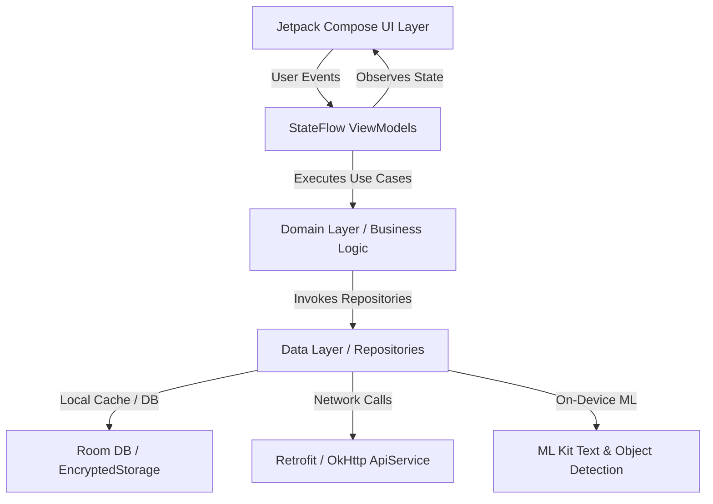

# SolarEase Android Architecture & Technical Design

## 1. Architectural Philosophy
SolarEase is built using modern Android architecture guidelines recommended by Google:
- **Declarative UI**: 100% Jetpack Compose with Material 3 design tokens.
- **Unidirectional Data Flow (UDF)**: ViewModels expose immutable `StateFlow<UiState>` to Composables; Composables emit user intents/events back to the ViewModel.
- **Offline-First & Local Persistence**: Encrypted local cache (EncryptedSharedPreferences) and Room database ensure core diagnostic and calculation features work without connectivity.
- **Edge Inference**: On-device machine learning with Google ML Kit (Text Recognition and Object Detection) for instant electricity meter recognition without uploading images to cloud servers.

## 2. High-Level System Architecture

## 3. Layer Breakdown

### Presentation Layer (`feature/*/ui`)
- **Composables**: Pure, stateless UI functions responsible for layout and interaction.
- **ViewModels**: Manage lifecycle-aware state machines, hold coroutine scopes (`viewModelScope`), and orchestrate UI events.
- **UiState**: Strongly typed immutable data classes representing entire screen states (e.g., Loading, Success, Error).

### Domain Layer (`feature/*/domain`)
- Independent of Android framework classes (except coroutines).
- Contains business rules, domain entities, tariff calculators, and validators.
- Defines repository interfaces.

### Data Layer (`feature/*/data`, `core/network`)
- **Repository Implementation**: Single source of truth coordinating remote API endpoints and local caching engines.
- **Network**: Retrofit 2 with Moshi serialization and custom token authenticator.
- **Security**: AES-256 GCM encrypted storage via AndroidX Security Crypto.

## 4. Navigation Architecture
- **Type-Safe Compose Navigation**: Powered by `androidx.navigation:navigation-compose` with Kotlin Serialization routes (`@Serializable sealed interface Screen`).
- No hardcoded string URLs or fragile bundle arguments.

## 5. Security Architecture
- Cleartext HTTP traffic is blocked in production via `network_security_config.xml`.
- Sensitive tokens and API keys are stored in `EncryptedSharedPreferences`.
- Keystore credentials are never stored in version control and are injected via CI environment secrets.

