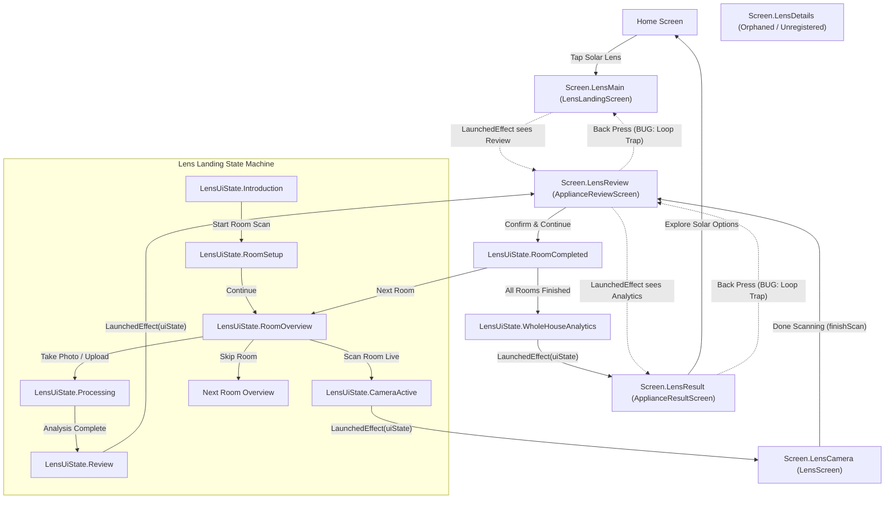
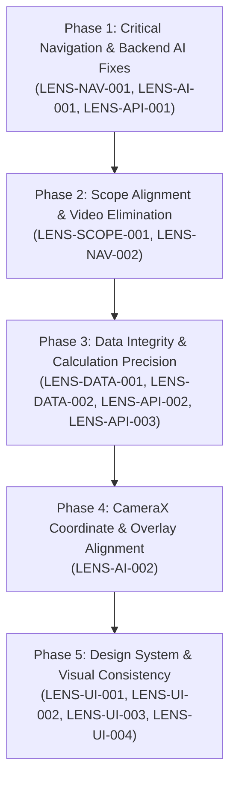

# SolarEase Solar Lens — Comprehensive Module Audit Report

**Audit Date:** October 11, 2026  
**Auditor:** Antigravity Agentic AI Assistant (Google DeepMind)  
**Target Repository:** SolarEase (Android Client & Antigravity Backend)  
**Branch Inspected:** `feature/home-meter-graph-upgrade`  
**Audit Scope:** Local local workspace inspection of Solar Lens Compose screens, CameraX/ML pipelines, state flows, backend routes, schemas, calculations, and security contracts.  
**Mode:** Inspection Only (Zero application code or configuration modified).

---

## 1. Executive Summary

This comprehensive audit evaluated the end-to-end architecture, user experience, camera/AI vision pipeline, data consistency, navigation graph, and backend services of the **SolarEase Solar Lens** module.

Solar Lens is designed to allow homeowners to audit their household appliances room-by-room, determine connected electrical load and monthly energy consumption, and size a rooftop solar PV system tailored to their consumption profile.

### Core Audit Takeaways:
1. **Critical Navigation Back-Stack Lock:** When users transition between `LensLandingScreen`, `ApplianceReviewScreen`, and `ApplianceResultScreen`, navigation is driven by reactive `LaunchedEffect(uiState)` blocks without resetting state upon back presses. This produces an inescapable loop: pressing back on the Review or Results screen immediately re-triggers forward navigation, trapping the user.
2. **Hallucinated Vision Model Identifier (`gemini-3.8-flash`):** Both Android client strings/logs and the backend service (`src/modules/lens/service.py`) reference the non-existent model `"gemini-3.8-flash"`. In live runtime against Vertex AI or Google GenAI API, this produces an immediate `404 Model Not Found` / `502 Bad Gateway`. Backend unit tests passed only because the GenAI client was completely mocked.
3. **Out-of-Scope Video Functionality:** Despite product requirements designating Solar Lens as strictly **image-only**, the local codebase contains active camera video recording (`CaptureVideo`), gallery video upload (`PickVisualMedia.VideoOnly`), video processing coroutines, deprecated frame extractors, and backend video multipart ingestion.
4. **Backend Schema Validation Rejection (`gt=0`):** Adding a custom appliance with 0W causes the backend Pydantic schema (`power_rating_watts: float = Field(..., gt=0)`) to reject the payload with `HTTP 422 Unprocessable Entity`. When `finishWholeHouse()` saves appliances, this error is swallowed, and the UI never displays the failure.
5. **CameraX Overlay Aspect Ratio Drift:** Bounding boxes from ML Kit are drawn on a full-screen Compose `Canvas` using raw normalized sensor coordinates. Because `PreviewView` uses `ScaleType.FILL_CENTER` on tall modern phone screens (e.g., 20:9), the camera feed is cropped and scaled without matching offset adjustments in the Canvas overlay, causing bounding boxes and labels to drift away from physical objects.
6. **Parallel Disjoint Design System:** `LensTheme.kt` implements a disconnected color palette (`0xFF16A34A` vs. the app's standard `0xFF3A7D44`) and hardcoded light surfaces with **zero Dark Theme support**, leading to high visual contrast and style fragmentation.

---

## 2. Actual Module Directory & File Map

### Android Client (`app/src/main/java/com/example/feature/lens/`)
```
app/src/main/java/com/example/feature/lens/
├── data/
│   ├── Appliance.kt                 # DTOs: Appliance, ApplianceCreateRequest, Detection, DetectionResult
│   ├── LensApi.kt                   # Retrofit interface: /lens/appliances and /lens/analyze
│   ├── LensRepository.kt            # Coroutine repository: network requests, error translation
│   └── LensRoomStorage.kt           # Local SharedPreferences room persistence engine
├── detector/
│   ├── ApplianceDetector.kt         # Interface: processFrame, processBitmap, close
│   ├── LensScanDetector.kt          # Camera preview & instant photo ML Kit bridge
│   ├── MlKitApplianceDetector.kt    # On-device Google ML Kit STREAM_MODE object detector
│   └── YoloApplianceDetector.kt     # Unused skeleton stub with TODOs
├── ui/
│   ├── theme/
│   │   └── LensTheme.kt             # Isolated LensColors & LensTypography palette
│   ├── ApplianceResultScreen.kt     # Whole-house summary, solar sizing, metric breakdown
│   ├── ApplianceReviewScreen.kt     # Room appliance list, slider/quantity adjustments
│   ├── LensLandingScreen.kt         # Multi-screen container: Intro, RoomSetup, RoomOverview, Processing, Done
│   ├── LensScreen.kt                # CameraX live scanning, viewfinder, bounding-box canvas overlay
│   └── LensViewModel.kt             # State machine (LensUiState), room management, calculations, sync
└── utils/
    ├── ApplianceAnalyzer.kt         # @Deprecated ML Kit object detector & labeler
    ├── ApplianceMaster.kt           # Authoritative appliance catalog (21 items), duty cycles, formulas
    ├── LensConstants.kt             # @Deprecated tariff rate pointer
    ├── LensUploadAnalyzer.kt        # Backend upload adapter (Gemini Cloud Vision)
    └── VideoFrameExtractor.kt       # @Deprecated MediaMetadataRetriever video frame extractor
```

### Connected Backend (`backend/src/modules/lens/`)
```
backend/src/modules/lens/
├── models.py                        # SQLAlchemy Appliance ORM model (table: 'appliances')
├── router.py                        # FastAPI router: CRUD /lens/appliances, POST /lens/analyze
├── schemas.py                       # Pydantic schemas: ApplianceCreate, ApplianceUpdate, DetectionResult
└── service.py                       # ApplianceService (DB) and ApplianceAnalysisService (Gemini Vision)
```

### Unit Tests
```
app/src/test/java/com/example/feature/lens/
├── ApplianceCalculatorTest.kt       # Tests duty cycles, operating wattage, monthly kWh formulas
├── ApplianceMasterTest.kt           # Tests appliance catalog lookups and default values
├── LensRoomStorageTest.kt           # Tests room storage serialization, reordering, persistence
└── LensViewModelTest.kt             # Robolectric test suite for Lens state machine

backend/
├── test_lens_auth.py                # Tests Firebase token validation on /lens/analyze
└── test_lens_gemini.py              # Tests mocked Gemini response parsing and null power ratings
```

---

## 3. Screen-by-Screen UI Consistency Audit

### 3.1 Screen 1: Introduction (`LensLandingScreen.kt:412-542`)
- **Visuals & Hierarchy:** Clean card-based overview explaining the 3-step audit process.
- **Inconsistency:** Uses hardcoded `LensColors.Primary` (`#16A34A`), which differs from SolarEase's core `PrimaryEnergy` (`#3A7D44`).
- **Dark Mode:** Completely unsupported. All card backgrounds are hardcoded to `#FAFAFA` and `#FFFFFF`. On dark mode devices, this results in an un-themed white canvas.
- **Button Spacing:** Bottom CTA height is 52.dp with 14.dp corner radius, whereas the standard SolarEase primary buttons use 48.dp with 12.dp corner radius.

### 3.2 Screen 2: Room Setup (`LensLandingScreen.kt:586-787`)
- **Layout & Interaction:** Allows adding, renaming, reordering, and deleting rooms.
- **Issues:**
  - Up/Down reordering icon buttons have small tap targets (32.dp outer bounding box with 18.dp icon), falling below the recommended 48×48 dp accessibility guideline.
  - Delete button displays a red cross with 70% opacity, but lacks a confirmation dialog; accidental taps immediately delete the room and all its assigned appliances.
  - Dialog text field has no maximum character limit enforcement.

### 3.3 Screen 3: Room Overview / Audit (`LensLandingScreen.kt:791-1012`)
- **Scope Violation:** Contains action buttons for "Record Video" (`onRecordVideoClicked`, lines 937–949) and "Upload Video" (`onUploadVideoClicked`, lines 970–982). This contradicts the image-only mandate.
- **Visual Weight:** "Scan Room Live" is rendered as a prominent filled primary button, while photo capture and upload options are smaller outlined buttons, creating bias toward live scan even though live scan does not categorize appliances.
- **Accessibility:** Room chips (e.g., target appliances text) use small 12.sp text on low-contrast surface `#F5F7F5`.

### 3.4 Screen 4: Camera Viewfinder & Live Scan (`LensScreen.kt:61-416`)
- **HUD & Overlay:** Uses `LensColors.InverseSurface` (`#1F2937`) for a dark camera HUD.
- **Hardcoded Colors:** Line 303 hardcodes `Color(0xFF22C55E)` for bounding box corner brackets instead of referencing theme tokens.
- **Bounding Box Misalignment:** Canvas overlay (`Modifier.fillMaxSize()`) computes pixel coordinates directly from relative coordinates (`rel.left * size.width`). However, `PreviewView` applies `ScaleType.FILL_CENTER` with aspect-ratio cropping. Consequently, bounding boxes drift significantly away from the physical appliance on 19.5:9 and 20:9 screens.
- **Labels:** Line 334–335 computes label position by multiplying `rel.left * maxWidth.value` (dp) and offsets with `.dp`. This mixes density-independent units with pixel bounds without aspect ratio correction.
- **Misleading Readout:** Line 354 displays `"~${detection.powerWatts.toInt()}W"`. Since `MlKitApplianceDetector` outputs generic objects with 0W, every detected box displays `~0W`, confusing users into thinking the appliance consumes zero watts.

### 3.5 Screen 5: Processing Overlay (`LensLandingScreen.kt:1016-1114`)
- **State Feedback:** Clean centered dialog with progress spinner and status text.
- **Hallucinated Model Readout:** Displays `"Analyzing with Gemini 3.8 Flash..."` when upload analysis is triggered.

### 3.6 Screen 6: Room Completed (`LensLandingScreen.kt:1118-1366`)
- **Metrics Display:** Displays 4 metric cards: Load (kW), Monthly Energy (kWh), Est. Cost (₹/mo), and Appliances found.
- **Visuals:** Well structured with green banner.
- **Formula Assumption Note:** Line 1223 states `"Estimate based on ₹7/kWh"`.

### 3.7 Screen 7: Appliance Review (`ApplianceReviewScreen.kt:31-712`)
- **Appliance Editing:** Users can change quantity, adjust daily usage hours via a slider, and pick appliance types from an exposed dropdown.
- **Missing Day-Frequency Control:** For appliances like washing machines or irons that run only 12–15 days a month, the UI provides **no control** to edit `monthlyUsageDays`. It forces users to adjust only daily hours.
- **Hidden Metric Adjustment:** The card calculates energy based on `activeOperatingWattage` and `dutyCycle`, but does not show either value to the user. Changing rated wattage scales active watts under the hood without transparency.
- **Validation Block:** Line 114 checks `hasInvalidAppliance = appliances.any { it.powerWatts <= 0f }`. If any appliance has 0W, it disables the confirm button. However, adding a custom appliance defaults to 0W without auto-opening the wattage dialog, causing confusion.

### 3.8 Screen 8: Results & Solar Sizing (`ApplianceResultScreen.kt:38-725`)
- **Metrics & Sizing:** Whole-house load, monthly consumption, estimated cost, proportional room energy bar, recommended solar PV system size, yearly savings, monthly generation, and offset percentage.
- **Fake "Download Report (PDF)" Feature:** Lines 571–588 render a "Download Report (PDF)" button. Tapping it simply displays a snackbar (`"Generating energy report for X rooms..."`) and performs no generation or download.
- **Misleading CTA:** Lines 552–570 render an "Explore Solar Options" primary button that calls `onNavigateHome`, redirecting the user to the generic Home screen rather than Solar Assessment or Vendor recommendations.
- **Hardcoded Colors:** Lines 72–75 hardcode hex colors (`Color(0xFF8B5CF6)`, `Color(0xFFF59E0B)`, `Color(0xFFEC4899)`, `Color(0xFF06B6D4)`) for the room breakdown chart.
- **Silent Save Failures:** The screen never reads or displays `viewModel.uiState.saveStatus`. Backend persistence failures are completely hidden.

---

## 4. Navigation Diagram & Transition Table

### 4.1 Navigation Flow Diagram



### 4.2 State Transition Table

| Trigger / User Action | Current Screen / UI State | Next Expected Destination | Actual Local Implementation | Finding / Defect |
|---|---|---|---|---|
| User enters Solar Lens | `Screen.Home` | `Screen.LensMain` (Intro) | Navigates to `Screen.LensMain`, ViewModel loads rooms | OK |
| Tap "Start Room Scan" | `LensUiState.Introduction` | `LensUiState.RoomSetup` | Changes `_uiState` to `RoomSetup` | OK |
| Tap "Continue" | `LensUiState.RoomSetup` | `LensUiState.RoomOverview` | Changes `_uiState` to `RoomOverview(firstRoom)` | OK |
| Tap "Scan Room Live" | `LensUiState.RoomOverview` | `Screen.LensCamera` | Sets `CameraActive`, `LaunchedEffect` triggers `onOpenCamera()` | OK |
| Camera Permission Denied | `Screen.LensCamera` | Permission Request UI | Shows permission dialog; if permanently denied, remains on black placeholder | Minor UX |
| Finish live scan | `Screen.LensCamera` | `Screen.LensReview` | Calls `viewModel.finishScan()`, sets `LensUiState.Review`, navigates to `Screen.LensReview` | OK |
| **System Back in Review** | `Screen.LensReview` | `Screen.LensMain` (Overview) | Calls `navController.popBackStack(Screen.LensMain, false)`, but does NOT call `popUiState()`. `uiState` remains `Review`. `LensLandingScreen`'s `LaunchedEffect` immediately re-navigates forward to `Screen.LensReview`! | **CRITICAL: Back loop trap (`LENS-NAV-001`)** |
| Tap "Confirm & Continue" | `Screen.LensReview` | `LensUiState.RoomCompleted` | Updates room appliances, saves to RoomStorage, sets `RoomCompleted` | OK |
| Tap "View Results" (Last Room) | `LensUiState.RoomCompleted` | `Screen.LensResult` | Calls `finishWholeHouse()`, sets `WholeHouseAnalytics`, triggers `onNavigateToAnalytics()` | OK |
| **System Back in Results** | `Screen.LensResult` | `Screen.LensMain` (Overview) | Calls `navController.popBackStack()`. Popped to `Screen.LensReview`. `ApplianceReviewScreen`'s `LaunchedEffect` sees `uiState is WholeHouseAnalytics` and immediately re-navigates forward to `Screen.LensResult`! | **CRITICAL: Back loop trap (`LENS-NAV-001`)** |
| Tap "Explore Solar Options" | `Screen.LensResult` | Solar Assessment / Vendor Screen | Navigates to `Screen.Home` | **Misleading routing (`LENS-UI-004`)** |
| Access `Screen.LensDetails` | N/A | Details screen | Defined in `Screen.kt` line 46, but missing from `NavGraph.kt` composable registry | **Dead Route (`LENS-NAV-002`)** |

---

## 5. Dummy Data, Value Mismatch & Calculation Audit

### 5.1 Value Mismatch & Traceability Table

| Value / Field | Detection / Input Tier | Default / Mapping Tier | ViewModel / Storage Tier | Backend Validation / DB | Result Display | Impact & Recommendation |
|---|---|---|---|---|---|---|
| **Appliance Wattage** | ML Kit outputs `null` / `0.0`. Upload outputs null or nameplate watts. | `ApplianceMaster` maps to `ratedWattage` (e.g., 65W for fan). | `EditableAppliance.powerWatts`. Custom item defaults to `0.0f`. | Backend `schemas.py` requires `gt=0`. Rejects `0.0f` with HTTP 422. | Formatted as `"${powerWatts.toInt()}W"`. | Custom appliances with 0W fail backend persistence. Change schema to `ge=0` or enforce positive input before submission. |
| **Active Operating Wattage** | Not detected. | Hardcoded in `ApplianceDef` (e.g. Fridge 150W, Laptop 30W vs 60W rated). | Computed via `activeOperatingWattage`. | **Not saved.** Backend table only stores `power_rating_watts`. | Displayed only as calculated kWh. | Discrepancy between client calculation and backend reconstructed metrics. |
| **Duty Cycle** | Not detected. | Fridge = 0.30, AC = 0.60, Iron = 0.60, others = 1.0. | Stored in `EditableAppliance.dutyCycle`. | **Not saved.** Backend table does not store duty cycle. | Hidden in calculation. | Fine on client, but backend has no visibility into intermittent duty cycle. |
| **Usage Hours / Day** | User slider (0.5 to 24h). | Defaults from `ApplianceMaster.typicalDailyHours`. | Stored in `EditableAppliance.usageHoursPerDay`. | `daily_usage_hours: float = Field(..., ge=0, le=24)`. | Displayed on review and result cards. | Aligned. |
| **Monthly Usage Days** | Fixed in code (no user UI control). | Defaults from `ApplianceMaster.monthlyDays` (e.g., 12, 15, 20, 30). | Stored in `EditableAppliance.monthlyUsageDays`. | **Not saved.** Backend schema has no `monthly_usage_days` column. | Hidden in monthly calculation. | Backend cannot reproduce monthly calculation because usage days are not persisted. |
| **Tariff Rate** | Static ₹7.0 / kWh (`EstimateConstants`). | Flat ₹7.0 rate. | `ApplianceMaster.authoritativeTariffRate` = 7.0. | Backend `calculate_tneb_bill` uses LT-1A telescopic slab tariff. | `≈ ₹${cost}/mo`. Note states estimate at ₹7/kWh. | Mismatch between Lens flat ₹7 assumption and TNEB slab billing engine. |
| **Simultaneous Load (kW)** | Calculated from connected load. | N/A | Computed in `ApplianceResultScreen`: `totalConnectedKw * 0.68`. | Not stored. | Displayed as metric card. | Magic multiplier `0.68` hardcoded directly in Compose UI instead of utility class. |
| **Recommended Solar PV (kW)** | Derived from daily kWh. | N/A | Computed in `ApplianceResultScreen`: `dailyAvgKwh / (4.5 * 0.79)`. Rounded to 0.5 kW steps, min 1 kW. | Not stored. | Displayed in recommendation banner. | Uses `4.5` PSH for sizing, but `4.33` PSH for monthly generation calculation. |
| **Solar Offset Percentage** | Derived from generation vs consumption. | N/A | `(solarMonthlyGen / totalMonthlyKwh * 100).coerceAtMost(150.0)`. | Not stored. | Bar & label. Fallback is hardcoded to `100.2%` when total monthly kWh is 0. | Fallback dummy number `100.2%` should be `0.0%` or hidden when consumption is zero. |

### 5.2 Specific Calculation Audit Findings
1. **Wattage Collision in Legacy Calculation (`ApplianceMaster.kt:387`):**
   ```kotlin
   fun calculateMonthlyKwh(powerWatts: Float, ...): Float {
       val def = appliances.find { it.ratedWattage == powerWatts }
   ```
   Both **Microwave** and **Air Conditioner (1.5T)** have `ratedWattage = 1200f`. Looking up an appliance definition purely by float wattage matches the first entry in the list (Air Conditioner with 0.60 duty cycle), erroneously cutting Microwave consumption by 40%.
2. **PSH Inconsistency in Sizing:**
   In `ApplianceResultScreen.kt:63-65`:
   - System size calculation uses `4.5` peak sun hours: `dailyAvgKwh / (4.5 * 0.79)`.
   - Monthly generation uses `4.33` peak sun hours: `recommendedPvKw * 4.33 * 30.0 * 0.79`.
   - Both should use a shared constant (e.g. `EstimateConstants.PEAK_SUN_HOURS = 4.5`).

---

## 6. Camera, Image & AI Integration Audit

### 6.1 Analyzer Execution Paths

Solar Lens currently possesses **two completely separate analyzer pipelines**:

1. **On-Device Real-Time Pipeline (`LensScanDetector` → `MlKitApplianceDetector`):**
   - **Invocation:** Triggered inside `LensScreen.kt` via CameraX `ImageAnalysis`.
   - **Model:** Google ML Kit Object Detection in `STREAM_MODE`.
   - **Output:** Generic bounding boxes with tracking IDs. Does NOT classify appliance categories (`label = "Object Candidate"`, `confidence = null`, `powerWatts = 0f`).
   - **Limitation:** User is forced to manually identify every detected object in the review screen.
2. **Cloud Vision Pipeline (`LensUploadAnalyzer` → Backend `/lens/analyze`):**
   - **Invocation:** Triggered when the user uploads photos from gallery or takes a still photo via camera contract.
   - **Model:** Google GenAI / Vertex AI Vision.
   - **Output:** Categorized appliances mapped to `appliance_type`, `quantity`, nameplate wattage inference, and visual evidence.
   - **Defect:** Model name is hardcoded to `"gemini-3.8-flash"`, causing live runtime failure.

### 6.2 CameraX Viewfinder & Bounding Box Coordinates
In `LensScreen.kt`:
```kotlin
// Line 296-300: Canvas overlay
val rel = detection.boundingBoxRelative
val left = rel.left * size.width
val top = rel.top * size.height
```
- `MlKitApplianceDetector.kt` computes `leftRel` and `topRel` by dividing bounding box coordinates by the rotated camera frame resolution (`rotatedWidth`, `rotatedHeight`, e.g., 640×480).
- `PreviewView` uses `scaleType = PreviewView.ScaleType.FILL_CENTER`. On modern mobile aspect ratios (19.5:9 or 20:9), the 4:3 camera stream is center-cropped to fill the screen vertically.
- Because the Compose `Canvas` spans the full screen without compensating for the crop offset or scale multiplier, bounding boxes are **stretched and displaced**, failing to align with real objects in the viewfinder.

### 6.3 Deprecated & Dead Detector Code
- `ApplianceAnalyzer.kt` is annotated with `@Deprecated("Replaced by Solar Lens pipeline architecture.")` and is completely unused in the project.
- `YoloApplianceDetector.kt` is an unimplemented placeholder with empty methods.
- `VideoFrameExtractor.kt` is annotated with `@Deprecated` and unused.
- `LensScanDetector.processRecordedScan(videoFile)` returns `emptyList()` without executing detection.

---

## 7. Android / Backend API Contract Audit

### 7.1 Endpoint Specifications

| Endpoint | Method | Auth Dependency | Request Body | Response Body | Contract Status |
|---|---|---|---|---|---|
| `/lens/analyze` | `POST` | Firebase ID Token (`get_verified_firebase_token`) | Multipart: `image` (File), `source` (Form) | `DetectionResult` | Schema matches; Model name broken (`gemini-3.8-flash`) |
| `/lens/appliances` | `GET` | User Access Token (`get_current_user`) | None | `List[ApplianceResponse]` | Implemented on backend; **Never queried by Android client** |
| `/lens/appliances` | `POST` | User Access Token (`get_current_user`) | `ApplianceCreate` | `ApplianceResponse` | Schema mismatch on `power_rating_watts gt=0` |
| `/lens/appliances/{id}` | `GET` | User Access Token (`get_current_user`) | None | `ApplianceResponse` | Backend only |
| `/lens/appliances/{id}` | `PATCH`| User Access Token (`get_current_user`) | `ApplianceUpdate` | `ApplianceResponse` | Backend only |
| `/lens/appliances/{id}` | `DELETE`| User Access Token (`get_current_user`)| None | Status 204 | Backend only |

### 7.2 Backend Schema Mismatch
In `backend/src/modules/lens/schemas.py`:
```python
class ApplianceBase(BaseModel):
    appliance_name: str = Field(..., max_length=255)
    appliance_type: str = Field(..., max_length=255)
    power_rating_watts: float = Field(..., gt=0)  # <-- STRICTLY GREATER THAN 0
```
In Android `LensViewModel.kt`:
```kotlin
val newAppliance = EditableAppliance(
    label = "Other / Custom Appliance",
    powerWatts = 0f, // <-- DEFAULTS TO 0.0
    ...
)
```
When submitted, FastAPI returns `422 Unprocessable Entity`:
```json
{"detail": [{"loc": ["body", "power_rating_watts"], "msg": "Input should be greater than 0", "type": "greater_than"}]}
```

### 7.3 Unbatched Network Synchronization
In `LensViewModel.finishWholeHouse()`:
```kotlin
for (room in allRooms) {
    for (appliance in room.appliances) {
        val request = ApplianceCreateRequest(...)
        val res = repository.createAppliance(request)
        if (res.isFailure) hadFailure = true
    }
}
```
If a household has 20 appliances across 4 rooms:
- The app executes **20 sequential HTTP requests**.
- There is no transactional batch endpoint (e.g. `POST /lens/appliances/batch` or `POST /lens/sync`).
- If request #12 fails, the first 11 appliances exist in the database, but the app marks the state as `PARTIAL_FAILURE`.
- Retrying will create **duplicate entries** for the first 11 appliances because there is no idempotency key or client-assigned UUID sync.

---

## 8. Authentication & Data Ownership Review

1. **Authentication Alignment:**
   - Client `AuthInterceptor.kt` inspects the URL:
     - For `/lens/analyze`, it acquires and attaches the Firebase ID Token (`Bearer <firebase_token>`).
     - For all other endpoints (including `/lens/appliances`), it attaches the SolarEase JWT token (`UserSession.accessToken`).
   - Backend `router.py` correctly uses `get_verified_firebase_token` for `/lens/analyze` and `get_current_user` for `/lens/appliances`.
2. **User Data Isolation & Ownership:**
   - In `ApplianceService.get_appliances`: `select(Appliance).where(Appliance.user_id == current_user.id)`.
   - In `ApplianceService.get_appliance`: `select(Appliance).where(Appliance.id == appliance_id, Appliance.user_id == current_user.id)`.
   - In `ApplianceService.update_appliance` and `delete_appliance`: Ownership is verified before commit.
   - **Conclusion:** Authorization and user isolation on the backend database are properly enforced.
3. **Write-Only Data Sink:**
   - Although the backend provides secure CRUD operations, the Android client only writes to it in `finishWholeHouse()`.
   - The app never calls `GET /lens/appliances` to populate saved rooms or sync state across devices.
   - If a user changes phones, all Solar Lens data is lost because local persistence relies entirely on SharedPreferences (`LensRoomStorage.kt`).

---

## 9. Error Handling, Lifecycle & Performance Risks

1. **Silent Save Failure (`ApplianceResultScreen.kt`):**
   - When network persistence fails during `finishWholeHouse()`, `LensUiState.WholeHouseAnalytics` is populated with `saveStatus = SaveStatus.FAILED` or `PARTIAL_FAILURE` and `errorMessage`.
   - `ApplianceResultScreen.kt` never observes `saveStatus` or `errorMessage`. The user is unaware that their audit was not saved to their account.
2. **Coroutine & Executor Cleanup:**
   - `LensScreen.kt` manages an `analysisExecutor` and `scanDetector` inside `DisposableEffect(lifecycleOwner)`:
     ```kotlin
     cameraProvider.unbindAll()
     scanDetector.close()
     analysisExecutor.shutdown()
     analysisScope.cancel()
     ```
     This cleans up threads properly when exiting the camera screen.
3. **Memory Pressure in Image Selection:**
   - In `LensViewModel.processUrisAsync`, the app iterates over selected photo URIs, decodes each into a Bitmap, compresses to JPEG, and accumulates all byte arrays in a single in-memory `byteArrayList`.
   - If a user selects 10 high-resolution camera images (12–48 MP each), this can cause temporary memory spikes approaching several hundred megabytes, risking `OutOfMemoryError` on budget Android devices.
4. **App Check Verification:**
   - Backend `/lens/analyze` has `_app_check: dict | None = Depends(verify_app_check)`. Since `_app_check` is optional (`| None`), requests without App Check tokens are permitted when App Check is unconfigured.

---

## 10. Accessibility & Responsive Layout Issues

1. **Touch Targets Below Minimum (48×48 dp):**
   - `LensLandingScreen.kt`: Room reorder arrows (`KeyboardArrowUp`, `KeyboardArrowDown`) and delete buttons have a modifier size of `32.dp`.
   - `ApplianceReviewScreen.kt`: Close/remove button is `32.dp`. Quantity +/- buttons are `28.dp`.
2. **Missing Content Descriptions:**
   - Many decorative and functional icons have `contentDescription = null` (e.g. `Icons.Default.Add` in review, `Icons.Default.WbSunny` in headers).
3. **Fixed Width Table Overflow:**
   - In `ApplianceResultScreen.kt:334`, the appliance summary table uses a hardcoded fixed width of `520.dp` wrapped in `horizontalScroll`. On screens with large font accessibility settings enabled, text clips inside columns (e.g. Appliance column fixed at 160.dp).
4. **Dark Mode Readability:**
   - The entire Solar Lens module is hardcoded to a light background (`LensColors.Background = Color(0xFFFAFAFA)`). When an Android user operates in system Dark Mode, Solar Lens ignores the system preference, displaying bright white surfaces.

---

## 11. Existing Tests, Executed Checks & Results

### 11.1 Checks Executed

| Test / Check Suite | Target / Command | Executed? | Result | Details |
|---|---|---|---|---|
| Android Lens Unit Tests | `.\gradlew.bat testDebugUnitTest --tests "com.example.feature.lens.*"` | **YES** | **PASSED** (36s) | All unit tests in `com.example.feature.lens` passed. |
| Backend Lens Unit Tests | `python -m unittest test_lens_auth.py test_lens_gemini.py` | **YES** | **PASSED** (0.191s) | 9 tests passed. |
| Git Branch & Status | `git status` | **YES** | **PASSED** | Branch: `feature/home-meter-graph-upgrade`. Working tree uncommitted changes preserved. |

### 11.2 Critical Note on Passing Tests vs. Runtime Reality
- While `test_lens_gemini.py` passed, it **mocks the Gemini client entirely**, meaning it only tests JSON parsing. It never catches that `gemini-3.8-flash` is an invalid model identifier that fails on actual Vertex AI / Google GenAI infrastructure.
- While `LensViewModelTest` passed, it uses `FakeLensApi` with dummy in-memory responses, masking the Pydantic `gt=0` schema failure and the back-navigation loop bug.

---

## 12. Prioritized Findings Table

| Finding ID | Severity | Category | File Path & Line | Description / Evidence | Confidence |
|---|---|---|---|---|---|
| **LENS-NAV-001** | **High** | Navigation | `ApplianceReviewScreen.kt:45-51`<br>`ApplianceResultScreen.kt:50`<br>`LensLandingScreen.kt:132-140` | **Inescapable Back-Navigation Loop Trap:** Back-press on Review or Results screen pops the backstack to `LensMain` while `uiState` remains `Review` or `WholeHouseAnalytics`. `LensLandingScreen`'s `LaunchedEffect(uiState)` instantly re-triggers forward navigation, trapping the user. | **Confirmed** |
| **LENS-AI-001** | **High** | Vision / AI | `backend/src/modules/lens/service.py:25`<br>`LensViewModel.kt:609,679,894` | **Non-Existent Vision Model (`gemini-3.8-flash`):** Google Vertex AI/GenAI has no model named `gemini-3.8-flash`. Calling the live backend endpoint results in an immediate 404/502 error. | **Confirmed** |
| **LENS-SCOPE-001** | **High** | Scope / Code Contradiction | `LensLandingScreen.kt:95-103, 262-276, 937-982`<br>`LensViewModel.kt:676-762` | **Video Recording & Upload Present in Image-Only Module:** The local codebase exposes video recording (`CaptureVideo`) and video upload (`PickVisualMedia.VideoOnly`) in direct contradiction to the image-only mandate. | **Confirmed** |
| **LENS-API-001** | **High** | Backend / Contract | `backend/src/modules/lens/schemas.py:9`<br>`LensViewModel.kt:487-495` | **Custom Appliance Backend Validation Rejection (`gt=0`):** Adding a custom appliance defaults to 0W. Backend schema rejects `power_rating_watts <= 0` with HTTP 422 Unprocessable Entity. | **Confirmed** |
| **LENS-API-002** | **High** | Data Persistence | `LensViewModel.kt:588-601`<br>`ApplianceResultScreen.kt:38-725` | **Silently Swallowed Save Failures:** `finishWholeHouse()` saves appliances asynchronously and tracks `saveStatus`, but `ApplianceResultScreen` never reads or displays errors to the user. | **Confirmed** |
| **LENS-AI-002** | **Medium** | Camera / Vision | `LensScreen.kt:296-300, 334-335`<br>`MlKitApplianceDetector.kt:54-58` | **Viewfinder Bounding Box Coordinate Misalignment:** Canvas overlay maps raw sensor bounds to screen size without compensating for `PreviewView.ScaleType.FILL_CENTER` aspect ratio crop, causing boxes to drift from physical appliances. | **Confirmed** |
| **LENS-DATA-001** | **Medium** | Calculation | `ApplianceMaster.kt:387` | **Brittle Appliance Lookup by Wattage:** `calculateMonthlyKwh` searches appliances by `ratedWattage == powerWatts`. Microwave (1200W, duty 1.0) collides with AC (1200W, duty 0.60), causing distorted energy calculations. | **Confirmed** |
| **LENS-API-003** | **Medium** | Backend / API | `LensViewModel.kt:567-583` | **Unbatched Sequential Network Requests:** Persisting 15 appliances fires 15 individual HTTP POST requests sequentially without transactional rollback or bulk sync. Multiple submissions create duplicate records. | **Confirmed** |
| **LENS-DATA-002** | **Medium** | Sizing Formula | `ApplianceResultScreen.kt:63-67` | **Inconsistent Sizing Constants & Dummy Fallback:** Sizing formula uses `4.5` PSH, while generation formula uses `4.33` PSH. Offset percentage defaults to dummy `100.2%` when consumption is 0. | **Confirmed** |
| **LENS-DATA-003** | **Medium** | UI / Usability | `ApplianceReviewScreen.kt:677-709` | **Missing Monthly Usage Days Control:** Users can adjust daily hours (0.5–24h), but cannot adjust monthly usage days (e.g. 12 days for washing machine). | **Confirmed** |
| **LENS-NAV-002** | **Low** | Navigation | `app/src/main/java/com/example/navigation/Screen.kt:46` | **Orphaned Dead Route `Screen.LensDetails`:** Declared in route enum but has no destination composable in `NavGraph.kt` and is never navigated to. | **Confirmed** |
| **LENS-UI-001** | **Low** | Design System | `com/example/feature/lens/ui/theme/LensTheme.kt` | **Parallel Theme Bypassing SolarEase Design Tokens:** Uses separate green shade (`#16A34A` vs `#3A7D44`) and has zero Dark Theme support. | **Confirmed** |
| **LENS-UI-002** | **Low** | UI Consistency | `LensScreen.kt:303`<br>`ApplianceResultScreen.kt:72-75` | **Hardcoded Hex Colors in Composables:** Direct hex color instantiations (`Color(0xFF22C55E)`, `Color(0xFF8B5CF6)`) bypass theme palette. | **Confirmed** |
| **LENS-UI-003** | **Low** | UI / UX | `ApplianceResultScreen.kt:571-588` | **Dummy PDF Download Button:** Displays a toast message without generating, exporting, or downloading any document. | **Confirmed** |
| **LENS-UI-004** | **Low** | UI / UX | `ApplianceResultScreen.kt:552-570` | **Misleading Navigation CTA:** "Explore Solar Options" button navigates to Home rather than Solar Assessment or Vendor recommendations. | **Confirmed** |
| **LENS-API-004** | **Informational** | Data Architecture | `LensRepository.kt:10-22` | **Write-Only Cloud Database:** Backend stores appliances, but client never fetches or restores them on reinstall. | **Confirmed** |
| **LENS-PERF-001** | **Informational** | Performance | `LensViewModel.kt:777-830` | **Memory Pressure in Batch Image Upload:** Reading multiple large images into memory simultaneously risks `OutOfMemoryError` on low-RAM devices. | **Likely** |

---

## 13. Recommended Remediation Sequence

When ready to implement fixes, the remediation should proceed in the following order:



### Phase 1: Critical Navigation & Backend Fixes (Prevent Crashes & Traps)
1. **Fix Back-Navigation Loop Trap (`LENS-NAV-001`):**
   - In `NavGraph.kt`, when popping back from `Screen.LensReview`, invoke `lensViewModel.popUiState()`.
   - In `ApplianceReviewScreen.kt`, remove the `LaunchedEffect` forwarding block for `WholeHouseAnalytics` so back-press from Results does not re-forward to Results.
   - Refactor `LensLandingScreen.kt` navigation triggers to use one-time event flows (e.g. `Channel<LensNavEvent>`) rather than reactive `uiState` checks.
2. **Correct Vision Model (`LENS-AI-001`):**
   - Change `GEMINI_MODEL` in backend `service.py` to a valid Google model (e.g. `gemini-1.5-flash` or `gemini-2.0-flash`).
   - Update client string resources in `LensViewModel.kt` to match.
3. **Resolve Custom Appliance Validation (`LENS-API-001`):**
   - Update `ApplianceReviewScreen.kt` to mandate positive wattage before saving custom items, and adjust backend `schemas.py` to `ge=0` with proper semantic handling.

### Phase 2: Scope Alignment & Video Elimination (Enforce Image-Only Mandate)
1. Remove `CaptureVideo` launcher and `VideoOnly` picker launcher from `LensLandingScreen.kt`.
2. Remove "Record Video" and "Upload Video" buttons from `RoomOverviewContent`.
3. Remove video analysis functions (`processVideoAsync`, `processVideoUploadAsync`) from `LensViewModel.kt`.
4. Delete deprecated `VideoFrameExtractor.kt`.
5. Remove orphan route `Screen.LensDetails` from `Screen.kt`.

### Phase 3: Data Integrity & Persistence Feedback
1. **Fix Wattage Collision (`LENS-DATA-001`):**
   - In `ApplianceMaster.kt`, change `calculateMonthlyKwh` to accept `applianceName: String` instead of relying solely on `powerWatts`.
2. **Display Save Status (`LENS-API-002`):**
   - Observe `saveStatus` in `ApplianceResultScreen.kt`. Display an error card and retry button if persistence fails.
3. **Harmonize Solar Sizing Constants (`LENS-DATA-002`):**
   - Use `EstimateConstants.PEAK_SUN_HOURS` consistently across sizing and generation calculations.

### Phase 4: CameraX Viewfinder & Bounding Box Alignment
1. **Viewfinder Coordinates (`LENS-AI-002`):**
   - Compute transformation matrix matching `PreviewView.ScaleType.FILL_CENTER` aspect ratio crop before projecting bounding box coordinates onto the Compose Canvas.

### Phase 5: Design System & Visual Polish
1. **Theme Alignment (`LENS-UI-001`):**
   - Integrate `LensColors` with `MaterialTheme.colorScheme` using `PrimaryEnergy` (`#3A7D44`) and add dark-mode color mappings.
2. **Action Corrections (`LENS-UI-003`, `LENS-UI-004`):**
   - Remove or implement the PDF export button.
   - Route "Explore Solar Options" to the assessment flow instead of `Screen.Home`.

---

## 14. Items Requiring Device Testing or Additional Verification

The following items could not be fully verified solely through local static inspection and unit tests:

1. **Physical Camera Sensor Rotation:**
   - ML Kit bounding box rotation behavior on devices with 270° sensor orientation (e.g., certain tablets or inverted front/back camera sensors) requires physical Android device testing.
2. **Live Vertex AI API Latency & Quotas:**
   - Actual response time and token latency of Google GenAI for 10MB multi-photo payloads against `solarease-bf39c` project credentials.
3. **Memory Pressure on 2GB RAM Devices:**
   - Decoding and resizing multiple 48MP camera images in `processUrisAsync` without triggering `OutOfMemoryError`.
4. **App Check Token Enforcement in Production:**
   - Whether Render production environment enforces `X-Firebase-AppCheck` headers or allows unverified client calls.

---

**Audit Report Completed.**  
*No application code, navigation graphs, themes, or backend configurations were altered during this inspection.*
