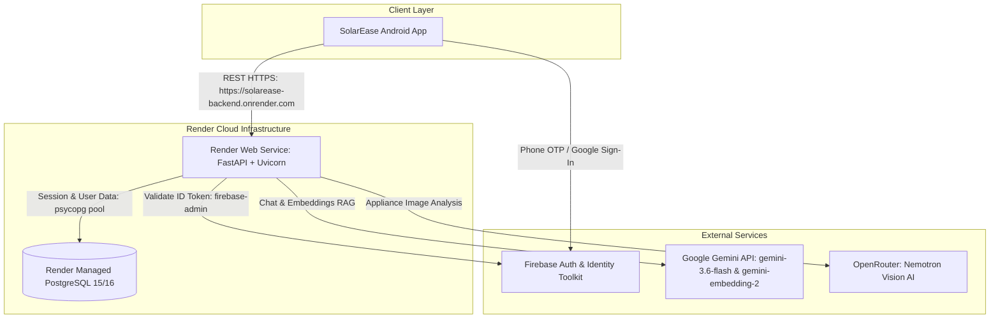

# Current SolarEase Backend Environment

## Backend
- **Framework:** FastAPI (`>=0.111.0`)
- **Python Version:** 3.11.9 (active virtualenv), 3.13+ (compatible / target)
- **ASGI Server:** Uvicorn (`uvicorn[standard]>=0.30.0`)
- **Entry Point:** `backend/src/main.py` (`app = create_app()`)
- **Deployment Platform:** Render Web Service
- **Production Base URL:** `https://solarease-backend.onrender.com/`
- **Active Routers:**
  - `/auth` (`src.modules.auth.router`): OTP management, Firebase token verification & PostgreSQL account sync, JWT issue/refresh, `/auth/me` profile management.
  - `/chatbot` (`src.modules.chatbot.router`): Bilingual solar/electrical QA assistant supporting Citizen, Student, and Professional modes.
  - `/lens` (`src.modules.lens.router`): AI appliance detection (`/lens/analyze`) and user appliance inventory CRUD (`/lens/appliances`).
  - `/healthz`: Render platform health check (`{"status": "healthy"}`).
  - `/health`: General service health check (`{"status": "ok", "message": "Service is healthy"}`).
  - `/`: Root greeting endpoint.
- **Middleware & Security:**
  - CORS middleware configured with dynamic JSON origins (`CORS_ORIGINS`).
  - OpenSSL CA certificate bundle configuration via `certifi` on startup.

## Database
- **Database Engine:** PostgreSQL
- **Database Driver:** `psycopg` (v3, `>=3.1.19` binary) via connection scheme `postgresql+psycopg://`
- **ORM:** SQLAlchemy 2.0 (`SQLAlchemy>=2.0.0`)
- **Connection Pool:** `pool_size=10`, `max_overflow=20`, `pool_pre_ping=True`
- **Hosting:** Render Managed PostgreSQL
- **Migration System:** Alembic (`alembic>=1.13.1`)
- **Migration Head:** `1686b036f6fc` (`add_lens_module_appliances_table`)
- **Migration State:** Clean, linear 8-step history:
  1. `1234567890ab`: `create_users_table`
  2. `2345678901bc`: `create_otp_verifications_table`
  3. `345678901cde`: `add_firebase_uid_to_users`
  4. `c335b955cd61`: `add_email_and_make_mobile_number_nullable`
  5. `9f120ed4f6b6`: `rename_full_name_to_username`
  6. `6934c1f034cb`: `add_house_address_to_users`
  7. `ffad56f9be91`: `add_profile_fields_and_username_unique`
  8. `1686b036f6fc` (HEAD): `add_lens_module_appliances_table`
- **Database Tables:**
  - `users`: Core user profile (UUID primary key, mobile number, email, firebase_uid, name, username, house address, GPS coordinates, verification status, timestamps).
  - `otp_verifications`: Legacy OTP audit log (UUID primary key, mobile number, hashed OTP, expiration, attempt count, verification flag, timestamps).
  - `appliances`: Solar Lens user audit inventory (UUID primary key, foreign key `user_id` referencing `users.id`, appliance name, category type, wattage, daily hours, quantity, monthly kWh, estimated cost, timestamps).
  - `alembic_version`: Alembic schema version tracking.
- **PostgreSQL-Specific Dependencies:**
  - `sqlalchemy.dialects.postgresql.UUID(as_uuid=True)` / `sa.UUID()` for native PostgreSQL UUID columns.
  - Server-default `now()` with timezone-aware `DateTime(timezone=True)`.

## Authentication
- **Firebase Authentication:**
  - Library: Google `firebase-admin>=6.5.0`
  - Token Verification: `firebase_admin.auth.verify_id_token(token, check_revoked=True)` in `src/modules/auth/dependencies.py`
  - Service Account Credential Path: `GOOGLE_APPLICATION_CREDENTIALS` (defaulting to `firebase-adminsdk.json`)
  - Integration: Mobile app logs in via Firebase (SMS OTP / Google Sign-In) and exchanges Firebase ID token at `/auth/firebase`.
- **Application JWT:**
  - Library: `python-jose[cryptography]>=3.3.0`
  - Algorithm: `HS256` using `JWT_SECRET_KEY`
  - Access Token Expiration: 15 minutes
  - Refresh Token Expiration: 30 days
  - Identity Model: Decodes user UUID claim (`sub`) and queries PostgreSQL `users` table via `get_current_user` dependency.

## AI & Machine Learning
- **Chatbot Knowledge Assistant:**
  - SDK: Google GenAI SDK (`google-genai>=0.1.0`)
  - Text Model: `gemini-3.6-flash`
  - Embedding Model: `gemini-embedding-2` for runtime user query vectorization
  - RAG Vector Store: In-memory normalized NumPy float32 matrix loaded at startup from `src/modules/chatbot/embeddings_index.json` (203 curated energy & solar concepts) with cosine similarity retrieval.
- **Solar Lens Appliance Detection:**
  - Provider: OpenRouter API (`https://openrouter.ai/api/v1/chat/completions`)
  - Vision Model: `nvidia/nemotron-3-nano-omni-30b-a3b-reasoning:free`
  - Client: `httpx>=0.27.0` (Async HTTP client with timeout and exponential retry handling)
  - Supported Appliance Categories: LED Tube Light, Ceiling Fan, Air Conditioner, Refrigerator, Television.

## Storage & File Handling
- **File Uploads:** In-memory streaming via FastAPI `UploadFile` (multipart/form-data) at `POST /lens/analyze`.
- **Object Storage:** None currently configured. Uploaded images are read into memory bytes, base64-encoded in-flight, passed to the vision AI provider, and released. No static persistent file store (S3 or Google Cloud Storage) is presently utilized.

## External Services & Integrations
- **Firebase Admin API:** Google Identity Toolkit token validation and public-key certificate retrieval.
- **Google Gemini API:** `generativelanguage.googleapis.com` for query answering and real-time query vectorization.
- **OpenRouter API:** `openrouter.ai` for Solar Lens vision-language reasoning.
- **TNEB Integration:** Handled entirely on the Android client (`TnebBillStatusWebView` & `TnebBillStatusHtmlParser`) via local web session scraping and CAPTCHA solving. No backend proxy or scraper is present in FastAPI.
- **Bill Calculator:** Handled entirely on the Android client (`EstimateCalculator`); no dedicated backend calculation service.
- **Background Tasks:** No Celery, Redis, or Cloud Tasks worker is currently configured; all FastAPI routes operate synchronously or asynchronously within the request lifecycle.

## Environment Variables
The application consumes the following environment variable keys (no values or secrets exposed):
- `PROJECT_NAME`: Display name of the FastAPI service.
- `ENVIRONMENT`: Environment mode (`development`, `staging`, `production`).
- `DEBUG`: Boolean flag for FastAPI debug mode.
- `DATABASE_URL`: Full PostgreSQL connection URI formatted for psycopg (`postgresql+psycopg://<user>:<password>@<host>:<port>/<dbname>`).
- `CORS_ORIGINS`: JSON array string specifying allowed CORS origins (e.g. `'["*"]'`).
- `JWT_SECRET_KEY`: Cryptographic signing secret for internal access and refresh JWTs.
- `JWT_ALGORITHM`: Signature algorithm (defaults to `HS256`).
- `GOOGLE_APPLICATION_CREDENTIALS`: File path to the Firebase Admin SDK service account JSON certificate.
- `GEMINI_API_KEY`: API key for Google Gemini model inference and embeddings.
- `OPENROUTER_API_KEY`: API key for OpenRouter vision detection.

## Current Architecture

