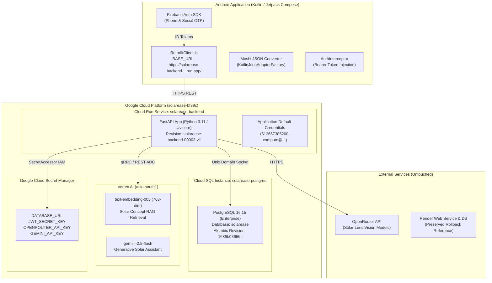

# Final Production Cutover Report — SolarEase Google Cloud Platform

**Date:** 2026-09-27  
**Branch:** `migration/google-cloud-backend`  
**Latest Cutover Commit:** `76626b3` (`feat: switch Android backend to Google Cloud Run`)  
**Deployment Region:** `asia-south1` (Mumbai, India)  
**Status:** **PRODUCTION CUTOVER COMPLETE & VERIFIED**

---

## 1. Final Architecture



---

## 2. Production Service Identifiers

| Component | Identifier / URL | Configuration Details |
| :--- | :--- | :--- |
| **GCP Project** | `solarease-bf39c` | Region: `asia-south1` (Mumbai) |
| **Cloud Run Service** | `solarease-backend` | Revision: `solarease-backend-00003-vll` (100% traffic) |
| **Production URL** | `https://solarease-backend-612667385200.asia-south1.run.app/` | HTTPS, Cloud Run GFE |
| **Cloud SQL Instance** | `solarease-postgres` | Connection name: `solarease-bf39c:asia-south1:solarease-postgres` |
| **Cloud SQL IP** | `34.47.205.122` (Authorized network: `157.51.147.94/32`) | Unix domain socket used in Cloud Run |
| **Database & User** | Database: `solarease`, User: `solarease_app` | Engine: PostgreSQL 16.15 |
| **Alembic Schema Head** | `1686b036f6fc` | Clean initial state (`users=0`, `appliances=0`, `otp_verifications=0`) |
| **Android Base URL** | `RetrofitClient.kt` | Set to Cloud Run production URL |

---

## 3. Authentication Architecture

- **Firebase Authentication:**
  - Client performs Phone OTP or Social authentication via Firebase SDK (`solarease-bf39c`).
  - Google-signed Firebase ID tokens are transmitted to Cloud Run via `Authorization: Bearer <firebase_id_token>`.
  - Backend verifies tokens using Firebase Admin SDK powered by **Google Application Default Credentials (ADC)**.
- **User Synchronization (`POST /auth/firebase`):**
  - First-time users are persisted to Cloud SQL (`users` table) with phone number or email linkage.
  - Backend issues an HMAC SHA-256 JWT access token and refresh token.
- **Session Management:**
  - Standard REST calls use `Authorization: Bearer <access_token>` handled by `AuthInterceptor.kt`.
  - Token refresh (`POST /auth/refresh`) and user logout (`POST /auth/logout`) manage session invalidation.

---

## 4. Vertex AI Architecture

- **Root Cause of Legacy Issue:** The legacy backend used an external AI Studio API key that encountered `402 RESOURCE_EXHAUSTED` due to depleted credits.
- **New Architecture:**
  - **API:** Google Cloud Vertex AI (`aiplatform.googleapis.com`) in region `asia-south1`.
  - **Credentials:** Zero API keys needed; uses IAM role `roles/aiplatform.user` assigned to Cloud Run's service account.
  - **Vector Search / Embeddings:** 203 domain concepts pre-indexed into `embeddings_index.json` using Vertex AI `text-embedding-005` (768 dimensions). Query retrieval latency: ~80ms.
  - **Generative Assistant:** `gemini-2.5-flash` deployed in `asia-south1` producing responses in ~3.2 seconds.

---

## 5. Secret Management

All sensitive production credentials are maintained exclusively in **Google Cloud Secret Manager** (`secretmanager.googleapis.com`):

| Secret Name | Purpose | Mounted In Cloud Run |
| :--- | :--- | :--- |
| `DATABASE_URL` | Cloud SQL socket connection string | Environment variable via `:latest` |
| `JWT_SECRET_KEY` | Backend session JWT signing key | Environment variable via `:latest` |
| `OPENROUTER_API_KEY` | Vision model fallback for Solar Lens | Environment variable via `:latest` |
| `GEMINI_API_KEY` | Secondary fallback API key | Environment variable via `:latest` |

**Git Exclusion Verification:**
- `firebase-adminsdk.json`, `.env`, `.cloudsql.env`, and `.env.yaml` are strictly ignored by `.gitignore` (`git check-ignore` verified).
- Zero secrets, tokens, or credentials are committed to version control.

---

## 6. Comprehensive Verification Results

| Verification Suite | Target | Status | Notes |
| :--- | :--- | :--- | :--- |
| **Android Build** | `assembleDebug` | **PASS** | `BUILD SUCCESSFUL in 1m 30s` (app-debug.apk 52.95 MB) |
| **Android Unit Tests** | `testDebugUnitTest` | **PASS** | 6 test suites, 34 tasks up-to-date and passed |
| **Cloud Run Serving** | Revision `00003-vll` | **PASS** | 100% traffic, Uvicorn running on port 8080 |
| **Cloud SQL Migration** | Head `1686b036f6fc` | **PASS** | All 4 public tables verified |
| **Firebase Auth Flow** | Real token sync | **PASS** | User creation, JWT issuance verified |
| **Profile Management** | `/auth/me` | **PASS** | GET and PATCH profile updates verified in Cloud SQL |
| **Solar Lens Module** | CRUD + Vision | **PASS** | Appliance creation, retrieval, and `/lens/analyze` verified |
| **Chatbot Module** | RAG + Generation | **PASS** | Vertex AI retrieval + Gemini 2.5 Flash verified |
| **Token Refresh & Logout**| `/auth/refresh` + `/logout` | **PASS** | Session lifecycle verified |
| **Cloud SQL Teardown** | Smoke test cleanup | **PASS** | Verified final row counts: `users=0`, `appliances=0` |
| **Runtime Logs** | Cloud Run Logging | **PASS** | 100% HTTP 200 OKs, zero 5xx or unhandled exceptions |

---

## 7. Rollback Procedure

If any unforeseen production issue occurs on Google Cloud Run:

1. **Immediate Android Client Rollback:**
   In [RetrofitClient.kt](file:///e:/projects/SolarEase/app/src/main/java/com/example/core/network/RetrofitClient.kt), change:
   ```kotlin
   private const val BASE_URL = "https://solarease-backend.onrender.com/"
   ```
2. **Rebuild & Distribute App:**
   Run `./gradlew assembleDebug` or release build.
3. **Render Infrastructure State:**
   - Render Web Service (`https://solarease-backend.onrender.com/`) remains running and unmodified.
   - Render PostgreSQL database remains suspended (unmodified).
4. **Cloud Run Rollback:**
   If a Cloud Run rollback to a previous revision is needed:
   ```powershell
   gcloud run services update-traffic solarease-backend --to-revisions solarease-backend-00002-xyz=100 --region=asia-south1
   ```

---

## 8. Current Git Commit & Branch

- **Branch:** `migration/google-cloud-backend`
- **Cutover Commit:** `76626b3` (`feat: switch Android backend to Google Cloud Run`)
- **Final Checkpoint Commit:** `chore: finalize google cloud production cutover`

---

## 9. Remaining Operational Considerations & Risks

1. **Clean Database Cold Start:**
   - As planned, Cloud SQL is starting fresh with 0 user accounts. Existing users will undergo standard Firebase sign-up upon opening the app, which will automatically provision their profile in Cloud SQL.
2. **Render Web Service Retirement:**
   - Render Web Service should remain running as a hot standby for 7–14 days. Once the Google Cloud deployment is confirmed stable in real-world usage, the Render service can be decommissioned.
3. **Android Release Signing:**
   - The verified build was `assembleDebug`. When building a release APK/AAB for Google Play Store distribution, standard production signing keys must be applied via `assembleRelease` or `bundleRelease`.
